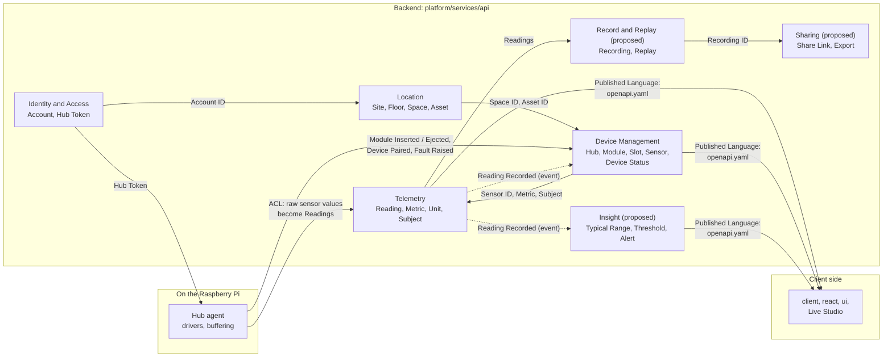

# Context Map

## Introduction

A **context map** shows the bounded contexts of the system and how they connect: which one provides data, which one uses it, and how they agree on its shape.

A **bounded context** is a boundary inside which every term has exactly one meaning. The contexts below were proposed in the [Domain Analysis](./domain-analysis.md#strategic-design-bounded-contexts). Terms follow the [Glossary](../../../kit/apps/docs-site/docs/domain-model/glossary.mdx). Contexts and terms marked _(proposed)_ aren't part of the glossary yet.

## Table of contents

[How to read the map](#how-to-read-the-map)

[Contexts at a glance](#contexts-at-a-glance)

[The map](#the-map)

[Relationship patterns](#relationship-patterns)

[Relationships in detail](#relationships-in-detail)

[Events between contexts](#events-between-contexts)

[Where each context lives in code](#where-each-context-lives-in-code)

[Rules for crossing a boundary](#rules-for-crossing-a-boundary)

[Open questions](#open-questions)

## How to read the map

- **Upstream** context: provides data or decisions. Changes here affect others.
- **Downstream** context: uses what upstream provides. It depends on upstream, not the other way round.
- Arrows point from **upstream to downstream**, the direction data flows.
- The label on an arrow says **what** crosses the boundary and, where it matters, the **pattern** used (see [Relationship patterns](#relationship-patterns)).

A simple test: if context A disappeared, would context B break? If yes, A is upstream of B.

## Contexts at a glance

| Context | Subdomain type | Owns | In the POC? |
| --- | --- | --- | --- |
| **Identity and Access** | Generic | Account, Hub Token | Hub Token only |
| **Location** | Supporting | Site, Floor, Space, Space Type, Asset, Asset Type | Later |
| **Device Management** | Core | Device, Hub, Module, Module Type, Slot, Sensor, Device Status | Yes |
| **Telemetry** | Core | Reading, Metric, Unit, Subject | Yes |
| **Insight** _(proposed)_ | Core | Typical Range, Threshold, Interpretation, Alert | Later |
| **Record and Replay** _(proposed)_ | Core | Recording, Replay | Later |
| **Sharing** _(proposed)_ | Supporting | Share Link, Export | Later |

Outside the domain, but on the map because they touch it:

| Participant | What it is |
| --- | --- |
| **Hub agent** | The Python software on the Raspberry Pi (`platform/hub`). It talks to hardware and sends data to the API. |
| **Client side** | `@detriz-sh-kit/client`, `@detriz-sh-kit/react`, `@detriz-sh-kit/ui` and Live Studio. They display the domain but own no domain rules. |

## The map

Solid arrows are data one context asks the other for. Dotted arrows are **events**: upstream announces that something happened, and downstream reacts.

**Telemetry ↔ Device Management** is the only pair that depends on each other. Device Management tells Telemetry which Sensors exist; Telemetry tells Device Management when Readings arrive, so it can decide on Stale. To avoid a tangle, the second direction goes **only through events**.

## Relationship patterns

DDD has names for the common ways two contexts can connect. These are the ones this project uses.

| Pattern | Plain meaning | Analogy | Used here |
| --- | --- | --- | --- |
| **Customer / Supplier** | Upstream (supplier) provides what downstream (customer) needs, and listens to its needs. | A kitchen that cooks what the waiter orders | Location → Device Management, Device Management → Telemetry |
| **Published Language** | A shared, documented format that many consumers rely on. | A standard plug shape | `openapi.yaml` between the backend, the Hub agent and the client side |
| **Open Host Service** | Upstream offers one public API for everyone, instead of a custom one per consumer. | A public library: same rules for every visitor | The public read API (sensors, Readings, history, stream) |
| **Anti-corruption Layer (ACL)** | A translator that stops a messy outside model leaking in. | An interpreter at a meeting | Hub agent drivers: I2C registers and raw counts become Readings |
| **Conformist** | Downstream takes upstream's model as it is, without translating. | Using a supplier's form exactly as printed | `client` uses types generated from `openapi.yaml` |

## Relationships in detail

| Upstream | Downstream | Pattern | What crosses | How |
| --- | --- | --- | --- | --- |
| Identity and Access | Location | Customer / Supplier | Account ID: who owns a Site | ID reference |
| Identity and Access | Hub agent | Published Language | Hub Token: proves which Hub is sending data | Secret in `hub/deploy/.env`, checked by the ingest API |
| Location | Device Management | Customer / Supplier | Space ID (where a Hub is placed), Asset ID (what a Sensor watches) | ID reference, checked by the Place Hub and Link Sensor to Asset commands |
| Hub agent | Device Management | Published Language (ingest API) | Module Inserted / Ejected, Device Detected, Device Paired, Fault Raised / Cleared | `PUT /hubs/{hubId}/modules` |
| Hub agent | Telemetry | ACL + Published Language (ingest API) | Batches of Readings, including buffered ones sent late | `POST /hubs/{hubId}/readings` |
| Device Management | Telemetry | Customer / Supplier | Which Sensors exist, their Metric and Subject | ID reference, looked up when a Reading arrives |
| Telemetry | Device Management | Events | Reading Recorded, used to decide Stale / Connected | Domain event |
| Telemetry | Insight _(proposed)_ | Events | Reading Recorded, checked against Thresholds | Domain event |
| Telemetry | Record and Replay _(proposed)_ | Customer / Supplier | Readings for a time window | Query |
| Record and Replay _(proposed)_ | Sharing _(proposed)_ | Customer / Supplier | Recording ID to share | ID reference |
| Device Management, Telemetry, Insight | Client side | Open Host Service + Published Language | Devices, Device Status, Readings, history, live stream | REST and WebSocket, described in `openapi.yaml` |
| `openapi.yaml` | `client` | Conformist | Generated TypeScript types | `openapi-typescript` |
| `client` | `react` → `ui` | Translation (small ACL) | Domain data mapped to component props | `Live*` components: `useSensor(id)` → props → `<Gauge />` |

The last row matters for the design system: `ui` never sees domain objects, only props. The `react` package is the one place that translates the domain into what components need. That keeps `ui` usable with any data source.

## Events between contexts

Events let a context react to another without calling it directly. All names are _(proposed)_; see [Device lifecycle](../../../kit/apps/docs-site/docs/domain-model/device-lifecycle.mdx#events-and-commands) for the full Device list.

| Event | Published by | Who reacts | What they do |
| --- | --- | --- | --- |
| **Reading Recorded** | Telemetry | Device Management | Moves a Stale Device back to Connected |
| **Reading Recorded** | Telemetry | Insight | Checks Thresholds; may raise **Threshold Crossed** |
| **Device Went Stale** | Telemetry (Staleness Policy) | Device Management | Sets Connection Status to Stale |
| **Hub Placed** | Device Management | Telemetry | New Readings from that Hub's Sensors get the new Space as Subject |
| **Device Removed** | Device Management | Telemetry | Stops accepting new Readings from its Sensors (past Readings stay) |
| **Space Deleted** | Location | Device Management | Unplaces Hubs in that Space and unlinks Sensors from its Assets |
| **Asset Removed** | Location | Device Management | Unlinks Sensors that watched it; their Readings go back to the Space as Subject |
| **Threshold Crossed** | Insight | Client side | Shows an Alert |

## Where each context lives in code

From the [architecture overview](../architecture-overview.md). Folder names under `domain/` are _(proposed)_: today the overview has one `domain/` folder.

| Context | Backend (Python) | Contract | Client side (TypeScript) |
| --- | --- | --- | --- |
| Identity and Access | `platform/services/api/.../domain/identity/` | ingest auth in `openapi.yaml` | — |
| Location | `platform/services/api/.../domain/location/` | `openapi.yaml` | `client` types |
| Device Management | `platform/services/api/.../domain/devices/` | `openapi.yaml` (hubs, modules) | `useHub`, `useConnectionStatus`; `ui/device/` (HubCard, ModuleSlot, ConnectionBadge, DeviceFaultStatus) |
| Telemetry | `platform/services/api/.../domain/telemetry/` | `openapi.yaml` (sensors, readings, history, stream) | `useSensor`, `useReadings`; `ui/sensor/` (Gauge, ReadingValue, HistoryChart) |
| Hub agent (ACL) | `platform/hub/drivers/`, `platform/hub/agent/` | ingest endpoints in `openapi.yaml` | — |

## Rules for crossing a boundary

1. **Refer to another context's things by ID only.** Device Management stores a Space ID, never a copy of the Space.
2. **Never reach into another context's data.** Ask through its public functions or listen to its events. (In code: no imports from another context's internal modules.)
3. **Translate at the edge.** Hardware details stop at the Hub agent. Domain objects stop at the `react` package; `ui` only gets props.
4. **One owner per term.** If two contexts need the same word, one owns its definition and the other only holds its ID (for example, Device Management owns Sensor; Telemetry only stores Sensor ID).
5. **Python and TypeScript share only `openapi.yaml`.** This is the Published Language, and it matches the dependency rules in the architecture overview.

## Open questions

- **Is Stale owned by Telemetry or Device Management?** The map has Telemetry detect it and Device Management store it. An alternative is to let Device Management run the Staleness Policy itself, using only Reading Recorded events.
- **Does the Hub agent need its own context?** Right now it's an ACL in front of Telemetry and Device Management. If on-hub logic grows (local history, local API for "talking to the Hub directly"), it may need its own model.
- **Where does Subject get decided?** When a Reading arrives, Telemetry needs the Sensor's Space and linked Asset. Does it ask Device Management and Location each time, or keep a local copy updated by events?
- **Should Location exist in the POC?** The POC only needs Hubs and Readings. Location could start as a single default Site and Space.
