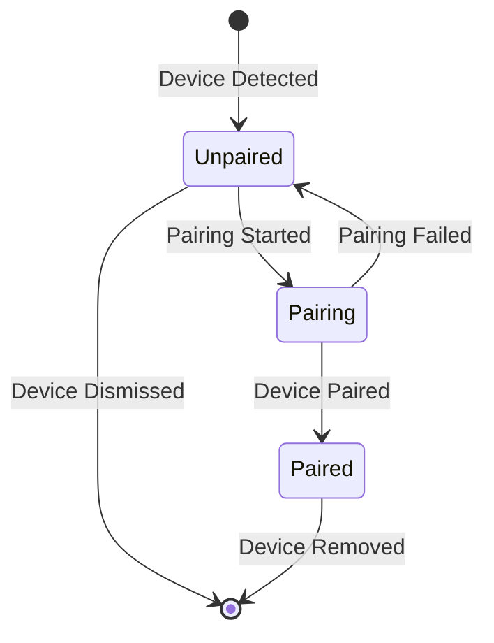
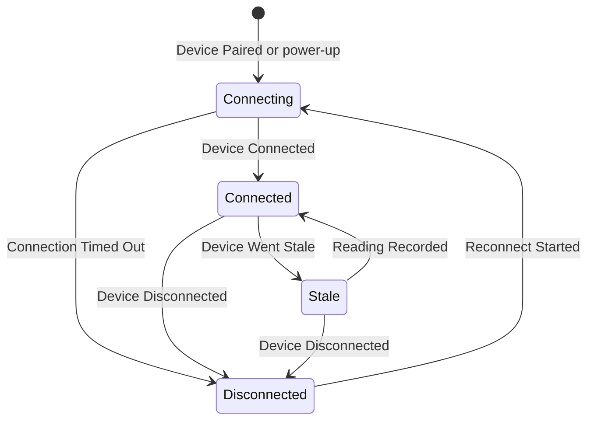
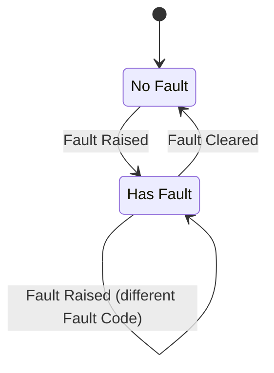
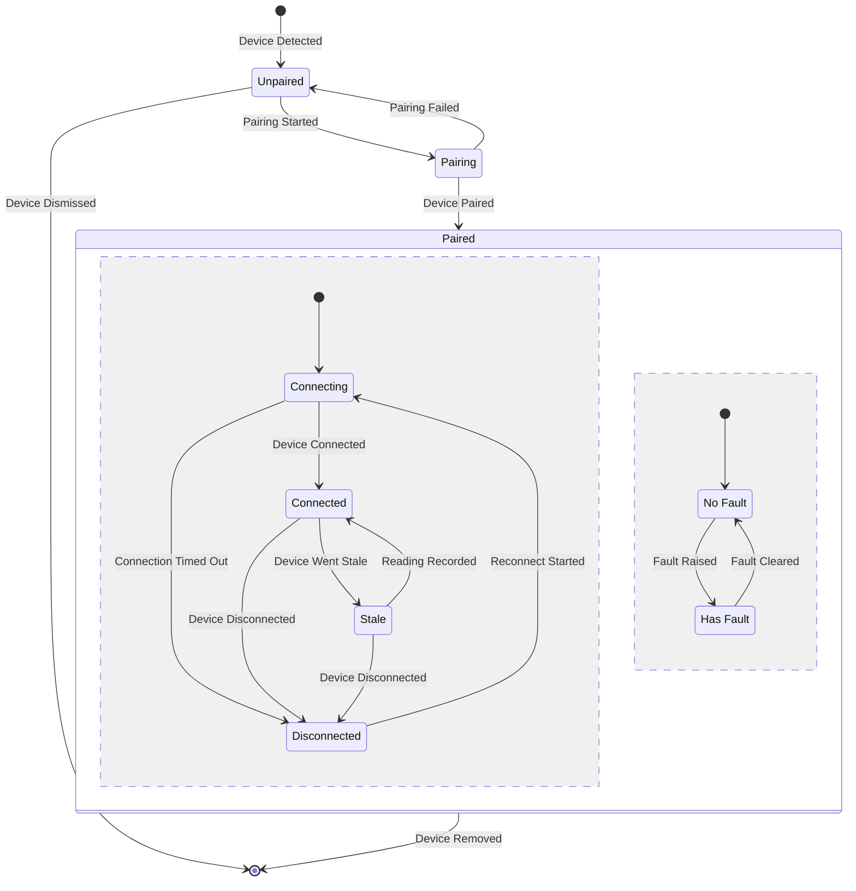
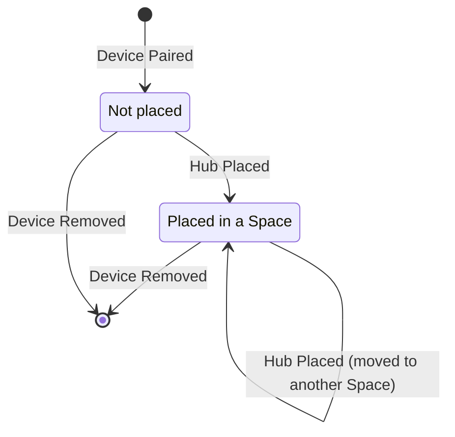
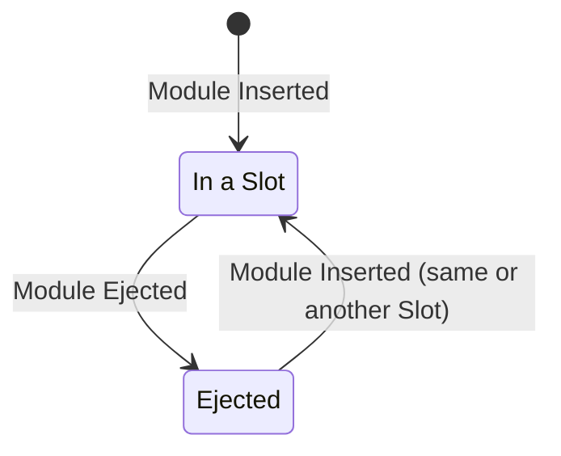
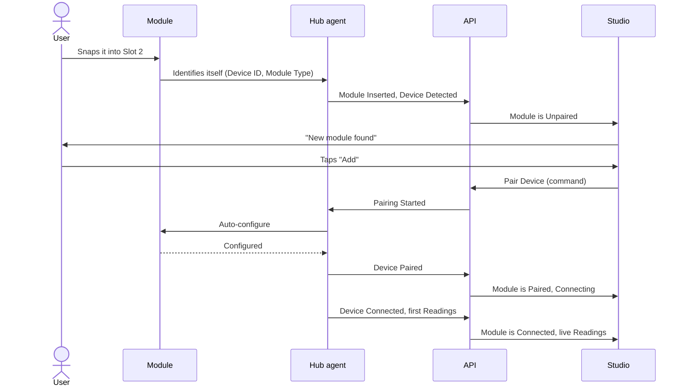
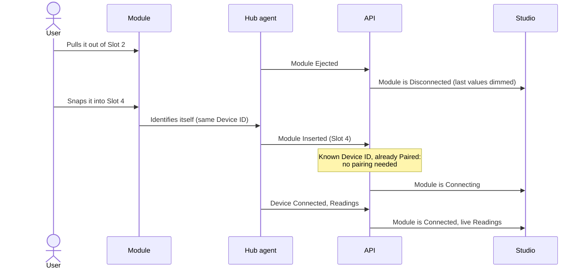

# Device Lifecycle

## Introduction

This document describes how a **Device** (a Hub or a Module) moves through its life: from being detected, through pairing and day-to-day connection, to being removed. It builds on the [Ubiquitous Language](./ubiquitous-language.md), [Relationships and Cardinality](./relationship-and-cardinality.md) and the [Domain Analysis](./domain-analysis.md#domain-events).

The statuses (Unpaired, Connected, …) come from the glossary. The **events** that move a Device between statuses (Device Paired, Device Went Stale, …) are _(proposed)_: they aren't part of the Ubiquitous Language until they are added to the glossary.

## Table of contents

[How to read the diagrams](#how-to-read-the-diagrams)

[Three independent fields](#three-independent-fields)

[Pairing Status](#pairing-status)

[Connection Status](#connection-status)

[Fault](#fault)

[The whole lifecycle](#the-whole-lifecycle)

[Hub and Module differences](#hub-and-module-differences)

[Flow: adding a new Module](#flow-adding-a-new-module)

[Flow: hot-swapping a Module](#flow-hot-swapping-a-module)

[Events and commands](#events-and-commands)

[Rules](#rules)

[What the UI shows](#what-the-ui-shows)

[Open questions](#open-questions)

## How to read the diagrams

The lifecycle diagrams are **state diagrams**:

- A **box** is a status the Device can be in.
- An **arrow** is a change of status. The label on the arrow is the **event** that causes it.
- `[*]` is the start (an arrow leaving it) or the end (an arrow going into it).
- A **box inside a box** means the inner statuses only exist while the Device is in the outer one.

The two flows near the end are **sequence diagrams**: each column is a participant, and time runs from top to bottom.

## Three independent fields

The glossary splits Device Status into three fields. Each one has its own small lifecycle:

| Field | Question | Exists when |
| --- | --- | --- |
| **Pairing Status** | Is this Device registered to the Account? | Always, from the moment the Device is detected |
| **Connection Status** | Can we reach it right now? | Only while the Device is **Paired** |
| **Fault** | Is the hardware healthy? | Always. It's independent of the other two |

Keeping them apart is what allows real combinations like "Connected **and** has a Fault", and makes impossible ones like "Unpaired **and** Stale" impossible to express.

## Pairing Status

Pairing answers "does this Device belong to the Account?". It changes rarely: usually once when the Device is added, and once when it's removed.

| Status | What it means | How it gets there |
| --- | --- | --- |
| **Unpaired** | The Device has been seen, but the user hasn't added it yet. | **Device Detected**: the Hub sees a new Module, or a new Hub comes online. Also **Pairing Failed**. |
| **Pairing** | First-time setup is running: joining the Account and auto-configuring. | **Pairing Started**: the user taps "Add". |
| **Paired** | The Device belongs to the Account. From now on it has a Connection Status. | **Device Paired**: setup finished. |

Leaving the lifecycle:

- **Device Dismissed** _(proposed)_: the user ignores a detected Device ("Not now"). It disappears from the list until it's detected again.
- **Device Removed**: the user removes a Paired Device from the Account. Its past Readings stay; the Device can be detected and paired again later.

## Connection Status

Connection answers "can we reach it right now?". It changes often: after every power cut, restart or Wi-Fi drop. It only exists while the Device is Paired.

| Status | What it means | How it gets there |
| --- | --- | --- |
| **Connecting** | Establishing or re-establishing the connection. | Right after **Device Paired**, after a power-up, or **Reconnect Started** after a dropped link. |
| **Connected** | Reachable, and Readings arrive on time. | **Device Connected**, or a **Reading Recorded** while Stale. |
| **Stale** | Still reachable, but no Reading arrived within the expected interval. | **Device Went Stale**, raised by the Staleness Policy in Telemetry. |
| **Disconnected** | Can't be reached. Last known values stay visible but dimmed. | **Device Disconnected**, or **Connection Timed Out** while Connecting. |

There is no end state: a Paired Device keeps cycling between these statuses until it is removed.

## Fault

Fault answers "is the hardware healthy?". The Device reports it about itself, so it is independent of pairing and connection.

- **Fault Raised** carries a **Fault Code**, for example `sensor_failure` or `calibration_required`.
- **Fault Cleared** happens when the Device stops reporting the problem, for example after recalibration.
- The glossary allows one Fault at a time, so a new Fault replaces the old one. See [Open questions](#open-questions).

## The whole lifecycle

All three fields together. Inside **Paired**, the dashed line splits two things that run **at the same time**: Connection Status on top and Fault below. Fault is shown only inside Paired here to keep the diagram readable; see [Open questions](#open-questions) about Faults on Unpaired Devices.

## Hub and Module differences

Hubs and Modules share the same three fields, but they reach them in different ways.

| | Hub | Module |
| --- | --- | --- |
| **Who detects it** | The API, when a new Hub first connects with its Hub Token _(proposed)_ | Its Hub, when the Module is snapped into a Slot |
| **Can be paired when** | Any time | Only when its Hub is Paired |
| **Gets a location** | **Hub Placed** in a Space, after it is Paired | Never directly. It's always in its Hub's Space |
| **Physical events** | Power-up, power cut, Wi-Fi drop | **Module Inserted**, **Module Ejected** (hot-swap) |
| **Connection depends on** | Its own link to the API | Its Hub. If the Hub is Disconnected, the Module is too |

### Hub placement

A Hub has a second, smaller lifecycle: where it is.

### Module in a Slot

A Module also has a physical lifecycle: whether it's snapped into a Slot. This is separate from pairing. A Paired Module can be ejected and stays Paired, which is how hot-swap keeps its identity.

## Flow: adding a new Module

What happens, step by step, when someone snaps a brand-new Climate Module into a Paired Hub.

## Flow: hot-swapping a Module

Moving a Paired Module from Slot 2 to Slot 4 on the same Hub. The Module keeps its Device ID, so it doesn't need to pair again and `useSensor(id)` keeps working.

## Events and commands

A **command** is a request that can be refused. An **event** is a fact: it already happened. All names below are _(proposed)_.

### Events

| Event | Field it changes | Raised by |
| --- | --- | --- |
| **Device Detected** | Pairing → Unpaired | Hub agent (Module) or API (Hub) |
| **Pairing Started** | Pairing → Pairing | API, after the Pair Device command |
| **Device Paired** | Pairing → Paired; Connection starts at Connecting | Hub agent |
| **Pairing Failed** | Pairing → Unpaired | Hub agent |
| **Device Dismissed** | Leaves the lifecycle | API, after the Dismiss Device command |
| **Device Removed** | Leaves the lifecycle | API, after the Remove Device command |
| **Device Connected** | Connection → Connected | Hub agent or API |
| **Device Went Stale** | Connection → Stale | Staleness Policy (Telemetry) |
| **Device Disconnected** | Connection → Disconnected | API (link lost) or Hub agent (Module ejected) |
| **Connection Timed Out** | Connection → Disconnected | API |
| **Reconnect Started** | Connection → Connecting | Hub agent or API |
| **Reading Recorded** | Connection Stale → Connected | Telemetry |
| **Fault Raised** / **Fault Cleared** | Fault | Hub agent (the Device reports it) |
| **Module Inserted** / **Module Ejected** | Slot occupancy | Hub agent |
| **Hub Placed** | Hub placement | API, after the Place Hub command |

### Commands

| Command | Who sends it | Refused when |
| --- | --- | --- |
| **Pair Device** | User | The Device isn't Unpaired, or it's a Module whose Hub isn't Paired |
| **Dismiss Device** | User | The Device isn't Unpaired |
| **Remove Device** | User | The Device isn't Paired |
| **Place Hub** | User | The Hub isn't Paired, or the Space is in another Account's Site |

## Rules

These add to the [invariants in the relationships doc](./relationship-and-cardinality.md#rules-the-diagrams-cant-show).

1. **Connection Status exists only while Paired.** (Already invariant 8.)
2. **A Paired Device always starts at Connecting**, never straight at Connected.
3. **A Module can be paired only when its Hub is Paired.**
4. **If a Hub is Disconnected, all its Modules are Disconnected.** When the Hub reconnects, its Modules go to Connecting.
5. **An ejected Module is Disconnected but stays Paired.** It keeps its Device ID and doesn't pair again when re-inserted.
6. **Stale is decided from Readings, not from the link.** A Device is Stale only if it is reachable but no Reading arrived within the expected interval.
7. **Fault never changes Pairing or Connection Status**, and they never clear a Fault.
8. **Removing a Device keeps its Readings.** History is never deleted by the lifecycle.

## What the UI shows

How each status maps to the design-system target states (see `CLAUDE.md`, "Component conventions").

| Device status | Component state | What the user sees |
| --- | --- | --- |
| Unpaired | (not a component state) | "New module found" with **Add** and **Not now** |
| Pairing | loading | Progress: "Setting up…" |
| Paired + Connecting | loading | "Connecting…" |
| Paired + Connected | Connected | Live value |
| Paired + Stale | Stale | Value with "Last update 5 min ago" |
| Paired + Disconnected | Disconnected | Last value, dimmed |
| Any + Has Fault | Fault | Fault message and help for its Fault Code, **on top of** the connection state |

## Open questions

- **Can an Unpaired Device have a Fault?** The glossary doesn't limit Fault to Paired Devices. If a newly detected Module reports `sensor_failure`, should "New module found" warn about it before pairing?
- **Several Faults at once?** The glossary allows one Fault per Device. A Module with two broken Sensors would need two.
- **Moving a Module to another Hub.** Does it stay Paired if both Hubs are in the same Account, or must it pair again?
- **How is a Hub detected?** Rule 3 says Modules need a Paired Hub, but nothing defines how a brand-new Hub is first seen and claimed (QR code, claim code, Hub Token?).
- **Expected interval for Stale.** Per Metric, per Module Type, or one global value? (Also listed in the [Domain Analysis](./domain-analysis.md#domain-services-and-policies).)
- **Late Readings.** When the Hub sends buffered Readings after a Wi-Fi drop, do they move a Device from Stale back to Connected?
