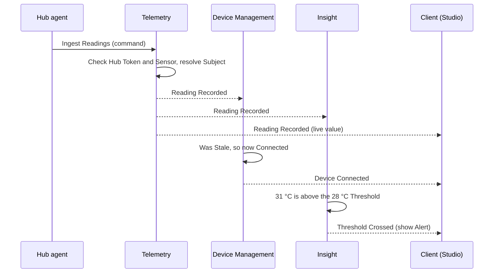

# Domain Events

## Introduction

A **domain event** is a record of something that happened in the domain, which other parts of the system may care about. "Device Paired" and "Reading Recorded" are domain events.

This document lists the events of DeTriz Smart Home KIT, grouped by the [bounded context](./context-map.md) that publishes them. It builds on the [Glossary](../../../kit/apps/docs-site/docs/domain-model/glossary.mdx), the [Device lifecycle](../../../kit/apps/docs-site/docs/domain-model/device-lifecycle.mdx) and the [Context Map](./context-map.md).

All event and command names here are _(proposed)_. They aren't part of the Ubiquitous Language until they are added to the glossary.

## Table of contents

[Event, command, status](#event-command-status)

[Naming rules](#naming-rules)

[What an event contains](#what-an-event-contains)

[Event catalogue](#event-catalogue)

[Commands and the events they cause](#commands-and-the-events-they-cause)

[Flow: one Reading through the system](#flow-one-reading-through-the-system)

[Which events reach the client](#which-events-reach-the-client)

[Rules](#rules)

[Open questions](#open-questions)

## Event, command, status

Three ideas that are easy to mix up:

| Idea        | Tense                            | Can it be refused?      | Example                     | Analogy                 |
| ----------- | -------------------------------- | ----------------------- | --------------------------- | ----------------------- |
| **Command** | Imperative: "do this"            | Yes                     | **Pair Device**             | Ordering a coffee       |
| **Event**   | Past: "this happened"            | No, it already happened | **Device Paired**           | The receipt             |
| **Status**  | Present: "this is how it is now" | —                       | Pairing Status = **Paired** | The coffee in your hand |

A command, if accepted, causes one or more events. Events change statuses. So the chain is always: **command → event → new status**.

Not every event comes from a command. Many come from the physical world: a Module is snapped in, Wi-Fi drops, a Sensor fails.

## Naming rules

1. **Past tense**: Device Paired, not Pair Device or Device Pairing.
2. **Use glossary terms exactly**: Module Ejected, not Card Removed or Plugin Unplugged.
3. **Name what happened, not what to do next**: Fault Raised, not Show Fault Message.
4. **One owner**: each event is published by exactly one bounded context.
5. **In docs**, write events with spaces (Device Paired). **In code and the API**, use PascalCase (`DevicePaired`).

## What an event contains

Every event has the same **envelope** (shared fields) plus its own **payload** (the details).

| Field        | Meaning                                                                                     | Example                |
| ------------ | ------------------------------------------------------------------------------------------- | ---------------------- |
| `eventId`    | Unique ID of this event, used to spot duplicates                                            | `evt_01HZX…`           |
| `type`       | Event name                                                                                  | `DevicePaired`         |
| `context`    | Bounded context that published it                                                           | `devices`              |
| `subjectId`  | ID of the thing it happened to (the aggregate root)                                         | `mod_7F3A…` (a Module) |
| `occurredAt` | When it happened in the real world                                                          | `2026-10-16T10:15:03Z` |
| `receivedAt` | When the API learned about it. Can be much later if the Hub buffered it during a Wi-Fi drop | `2026-10-16T10:17:40Z` |
| `version`    | Payload format version, so it can change safely later                                       | `1`                    |
| `payload`    | The event-specific details                                                                  | see below              |

Example: **Device Paired**

```json
{
  "eventId": "evt_01HZX9K2",
  "type": "DevicePaired",
  "context": "devices",
  "subjectId": "mod_7F3A",
  "occurredAt": "2026-10-16T10:15:03Z",
  "receivedAt": "2026-10-16T10:15:03Z",
  "version": 1,
  "payload": {
    "deviceKind": "Module",
    "moduleType": "Climate",
    "hubId": "hub_K1",
    "slotNumber": 2
  }
}
```

Example: **Reading Recorded**

```json
{
  "eventId": "evt_01HZXA01",
  "type": "ReadingRecorded",
  "context": "telemetry",
  "subjectId": "mod_7F3A:temperature",
  "occurredAt": "2026-10-16T10:15:03Z",
  "receivedAt": "2026-10-16T10:15:04Z",
  "version": 1,
  "payload": {
    "sensorId": "mod_7F3A:temperature",
    "metric": "Temperature",
    "value": 22.4,
    "unit": "°C",
    "subject": { "kind": "Space", "id": "spc_kitchen" }
  }
}
```

The payload carries **IDs**, not whole objects. Reading Recorded points to its Subject with `{ "kind": "Space", "id": … }`, not a full copy of the Space. (Sensor ID = Module ID + Metric, as proposed in the [Domain Analysis](./domain-analysis.md#entities-need-a-defined-identity).)

## Event catalogue

Each table lists the events one context publishes. **Consumers** are the contexts or apps that react. **Public** means the event is sent to the client (see [Which events reach the client](#which-events-reach-the-client)).

### Identity and Access

| Event                 | What happened                  | Key payload | Consumers                         | Public |
| --------------------- | ------------------------------ | ----------- | --------------------------------- | ------ |
| **Account Created**   | Someone signed up              | `accountId` | Location (creates a default Site) | No     |
| **Hub Token Issued**  | A Hub got a token to send data | `hubId`     | Hub agent                         | No     |
| **Hub Token Revoked** | A Hub's token was cancelled    | `hubId`     | Ingest API (rejects its data)     | No     |

### Location

| Event             | What happened                 | Key payload                                  | Consumers                               | Public |
| ----------------- | ----------------------------- | -------------------------------------------- | --------------------------------------- | ------ |
| **Site Created**  | A new Site was added          | `siteId`, `accountId`, `name`                | —                                       | Yes    |
| **Floor Added**   | A Floor was added to a Site   | `floorId`, `siteId`, `name`                  | —                                       | Yes    |
| **Space Created** | A new Space was added         | `spaceId`, `siteId`, `spaceType`, `floorId?` | —                                       | Yes    |
| **Space Renamed** | A Space got a new name        | `spaceId`, `name`                            | —                                       | Yes    |
| **Space Deleted** | A Space was removed           | `spaceId`                                    | Device Management (unplaces its Hubs)   | Yes    |
| **Asset Added**   | An Asset was added to a Space | `assetId`, `spaceId`, `assetType`            | —                                       | Yes    |
| **Asset Removed** | An Asset was removed          | `assetId`                                    | Device Management (unlinks its Sensors) | Yes    |

### Device Management

Lifecycle events are explained with diagrams in [Device lifecycle](../../../kit/apps/docs-site/docs/domain-model/device-lifecycle.mdx).

| Event                          | What happened                                      | Key payload                                                                           | Consumers                                  | Public |
| ------------------------------ | -------------------------------------------------- | ------------------------------------------------------------------------------------- | ------------------------------------------ | ------ |
| **Device Detected**            | A new Device was seen (Pairing Status → Unpaired)  | `deviceId`, `deviceKind`, `moduleType?`, `hubId?`                                     | Client ("New module found")                | Yes    |
| **Pairing Started**            | The user started adding a Device (→ Pairing)       | `deviceId`                                                                            | Hub agent (starts auto-configure)          | Yes    |
| **Device Paired**              | Setup finished (→ Paired, Connection → Connecting) | `deviceId`, `deviceKind`, `hubId?`, `slotNumber?`                                     | Telemetry (starts accepting its Readings)  | Yes    |
| **Pairing Failed**             | Setup failed (→ Unpaired)                          | `deviceId`, `reason`                                                                  | Client                                     | Yes    |
| **Device Dismissed**           | The user chose "Not now"                           | `deviceId`                                                                            | —                                          | Yes    |
| **Device Removed**             | A Paired Device left the Account                   | `deviceId`                                                                            | Telemetry (stops accepting its Readings)   | Yes    |
| **Module Inserted**            | A Module was snapped into a Slot                   | `moduleId`, `hubId`, `slotNumber`                                                     | —                                          | Yes    |
| **Module Ejected**             | A Module was pulled out of a Slot                  | `moduleId`, `hubId`, `slotNumber`                                                     | —                                          | Yes    |
| **Module Turned Off**          | The user turned a Module Off (→ Disconnected)      | `moduleId`, `hubId`                                                                   | Client                                     | Yes    |
| **Module Turned On**           | The user turned a Module On (→ Connecting)         | `moduleId`, `hubId`                                                                   | Client                                     | Yes    |
| **Hub Placed**                 | A Hub was placed in, or moved to, a Space          | `hubId`, `spaceId`, `previousSpaceId?`                                                | Telemetry (new Subject for new Readings)   | Yes    |
| **Sensor Linked to Asset**     | A Sensor now watches an Asset                      | `sensorId`, `assetId`                                                                 | Telemetry (new Subject for new Readings)   | Yes    |
| **Sensor Unlinked from Asset** | A Sensor stopped watching an Asset                 | `sensorId`, `assetId`                                                                 | Telemetry (Subject goes back to the Space) | Yes    |
| **Device Connected**           | Connection → Connected                             | `deviceId`                                                                            | —                                          | Yes    |
| **Device Disconnected**        | Connection → Disconnected                          | `deviceId`, `reason` (link lost, Module ejected, Module turned Off, Hub disconnected) | —                                          | Yes    |
| **Connection Timed Out**       | Connecting took too long (→ Disconnected)          | `deviceId`                                                                            | —                                          | Yes    |
| **Reconnect Started**          | Connection → Connecting                            | `deviceId`                                                                            | —                                          | Yes    |
| **Fault Raised**               | The Device reported a hardware problem             | `deviceId`, `faultCode`, `sensorId?`                                                  | Client (shows Fault message)               | Yes    |
| **Fault Cleared**              | The Device stopped reporting the problem           | `deviceId`, `faultCode`                                                               | Client                                     | Yes    |

### Telemetry

| Event                 | What happened                                          | Key payload                                      | Consumers                                                                        | Public |
| --------------------- | ------------------------------------------------------ | ------------------------------------------------ | -------------------------------------------------------------------------------- | ------ |
| **Reading Recorded**  | A Reading was stored                                   | `sensorId`, `metric`, `value`, `unit`, `subject` | Device Management (Stale → Connected), Insight, Record and Replay, client stream | Yes    |
| **Device Went Stale** | No Reading within the expected interval (Modules only) | `deviceId`, `lastReadingAt`                      | Device Management (sets Stale)                                                   | Yes    |

### Insight _(proposed context)_

| Event                   | What happened                           | Key payload                                                                | Consumers                 | Public |
| ----------------------- | --------------------------------------- | -------------------------------------------------------------------------- | ------------------------- | ------ |
| **Threshold Crossed**   | A Reading went outside a Threshold      | `thresholdId`, `sensorId`, `subject`, `value`, `direction` (above / below) | Client (shows an Alert)   | Yes    |
| **Threshold Recovered** | Readings came back inside the Threshold | `thresholdId`, `sensorId`                                                  | Client (clears the Alert) | Yes    |

### Record and Replay _(proposed context)_

| Event                 | What happened              | Key payload                             | Consumers | Public |
| --------------------- | -------------------------- | --------------------------------------- | --------- | ------ |
| **Recording Started** | The user started recording | `recordingId`, `sensorIds`              | —         | Yes    |
| **Recording Stopped** | The user stopped recording | `recordingId`, `startedAt`, `stoppedAt` | Sharing   | Yes    |

### Sharing _(proposed context)_

| Event                  | What happened                  | Key payload                   | Consumers | Public |
| ---------------------- | ------------------------------ | ----------------------------- | --------- | ------ |
| **Share Link Created** | A shareable link was made      | `shareLinkId`, `recordingId?` | —         | No     |
| **Share Link Revoked** | A shareable link was cancelled | `shareLinkId`                 | —         | No     |

## Commands and the events they cause

| Command                  | Context           | Sent by   | If accepted                                           | Refused when                                                   |
| ------------------------ | ----------------- | --------- | ----------------------------------------------------- | -------------------------------------------------------------- |
| **Pair Device**          | Device Management | User      | Pairing Started, then Device Paired or Pairing Failed | Device isn't Unpaired, or it's a Module whose Hub isn't Paired |
| **Dismiss Device**       | Device Management | User      | Device Dismissed                                      | Device isn't Unpaired                                          |
| **Remove Device**        | Device Management | User      | Device Removed                                        | Device isn't Paired                                            |
| **Place Hub**            | Device Management | User      | Hub Placed                                            | Hub isn't Paired, or the Space belongs to another Account      |
| **Turn Module Off**      | Device Management | User      | Module Turned Off, then Device Disconnected           | Module isn't Paired, or its Hub is Disconnected                |
| **Turn Module On**       | Device Management | User      | Module Turned On, then Reconnect Started              | Module isn't Paired, or its Hub is Disconnected                |
| **Link Sensor to Asset** | Device Management | User      | Sensor Linked to Asset                                | The Asset is in a different Space than the Sensor's Hub        |
| **Create Space**         | Location          | User      | Space Created                                         | The Site belongs to another Account                            |
| **Add Asset**            | Location          | User      | Asset Added                                           | The Space doesn't exist                                        |
| **Ingest Readings**      | Telemetry         | Hub agent | Reading Recorded (one per Reading)                    | Hub Token invalid, or the Sensor isn't Paired                  |
| **Start Recording**      | Record and Replay | User      | Recording Started                                     | A Recording is already running                                 |

## Flow: one Reading through the system

What happens when the Hub agent sends one temperature Reading for a Module that was Stale and is above its Threshold.



Solid arrows are commands or internal work. Dashed arrows are events. Note that Telemetry doesn't call Device Management or Insight: it publishes one event, and each of them reacts on its own.

## Which events reach the client

Inside the backend, events let contexts react to each other. Some of them are also sent to the client over the **WebSocket stream**, which is how `useSensor` and `useConnectionStatus` stay live.

| Group                                 | Sent to the client? | Why                                                                       |
| ------------------------------------- | ------------------- | ------------------------------------------------------------------------- |
| Reading Recorded                      | Yes                 | Live values for `useSensor`, Gauge, HistoryChart                          |
| Connection and Fault events           | Yes                 | Live status for `useConnectionStatus`, ConnectionBadge, DeviceFaultStatus |
| Pairing, Module and Hub Placed events | Yes                 | Studio updates the Device list without reloading                          |
| Location events                       | Yes                 | Studio updates the Site and Space tree                                    |
| Insight events                        | Yes                 | Alerts                                                                    |
| Identity and Sharing events           | No                  | Internal or security-related                                              |

Events sent to the client are part of the **Published Language**, so they must be described in `openapi.yaml` (or an AsyncAPI file next to it) and versioned like any other API.

## Rules

1. **Events never change.** Like Readings, once an event is recorded it is a fact. A mistake is fixed with a new event, not by editing the old one.
2. **Each event has one publisher.** Only Device Management publishes Device Paired.
3. **Payloads carry IDs, not copies.** Consumers look up details they need, so they never hold stale copies.
4. **Handle duplicates.** The Hub agent resends buffered data after a Wi-Fi drop, so the same event can arrive twice. Consumers use `eventId` to ignore repeats.
5. **Order by `occurredAt` per subject.** Events for one Device are applied in the order they happened, even if they arrive out of order. Late events don't overwrite newer statuses.
6. **Events describe the domain, not the UI.** Fault Raised, not Show Error Toast. The client decides how to display it.

## Open questions

- **One event per Reading, or per batch?** The Hub agent sends Readings in batches. Publishing Reading Recorded for each one is simplest, but a **Readings Ingested** batch event may be needed at higher volume.
- **Who publishes Device Went Stale?** Here it's Telemetry, matching the [Context Map](./context-map.md#open-questions). If Device Management runs the Staleness Policy instead, the event moves there.
- **Store events, or just publish them?** Saving every event (event sourcing) gives a full history but adds complexity. For the POC, publishing events and storing only current statuses and Readings is enough. Worth an ADR if this changes.
- **AsyncAPI or OpenAPI for the stream?** OpenAPI describes REST well but WebSocket messages poorly. AsyncAPI is the usual companion format for events.
