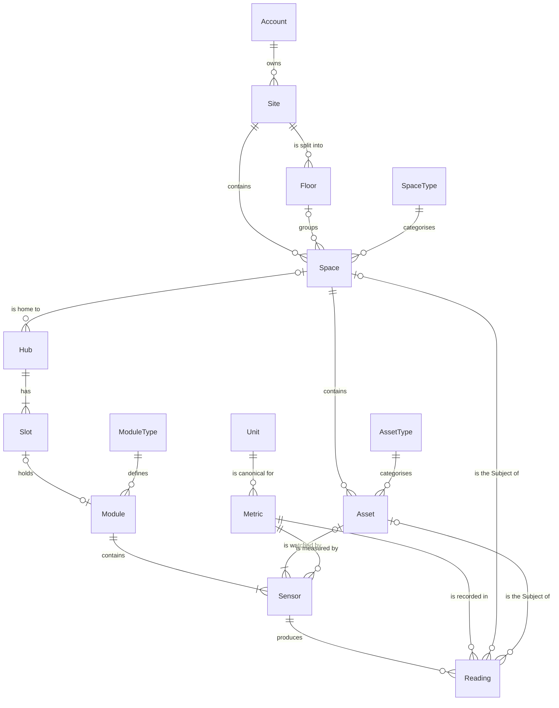
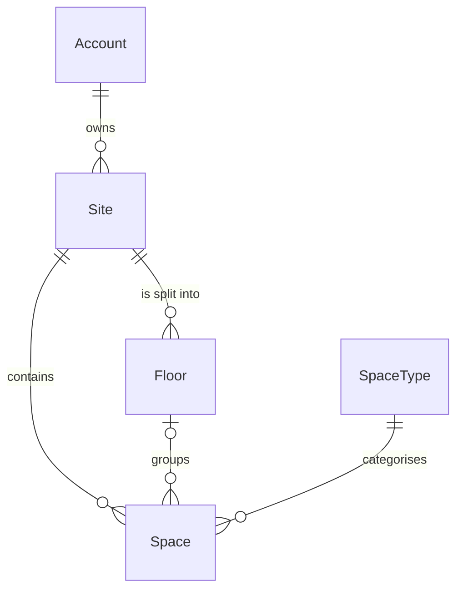
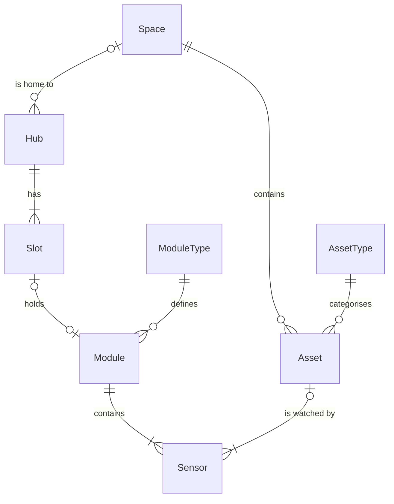
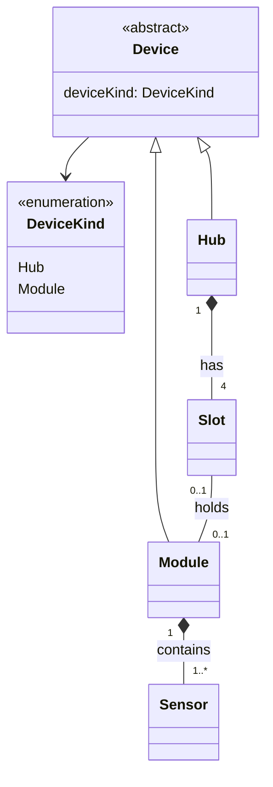
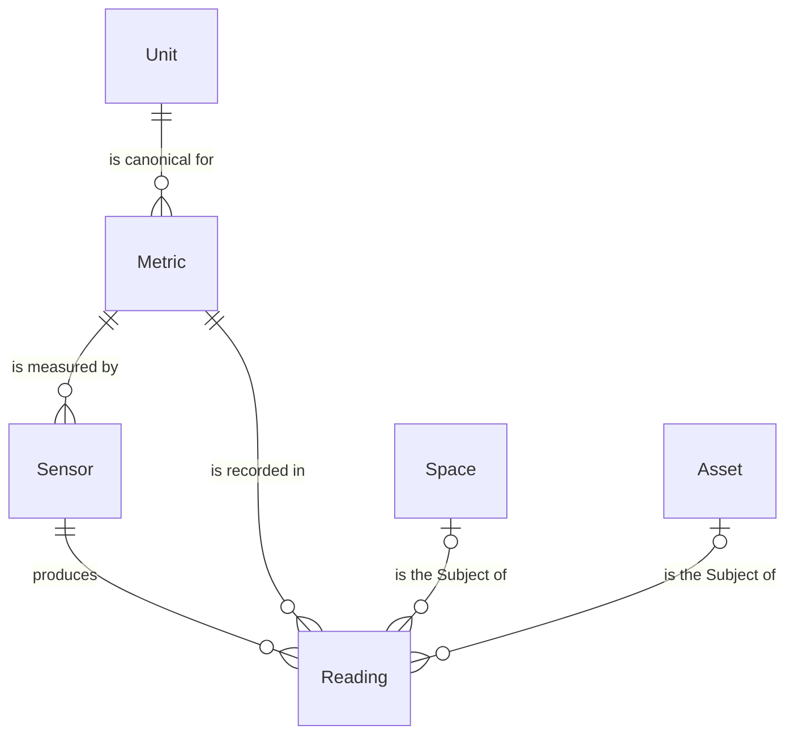
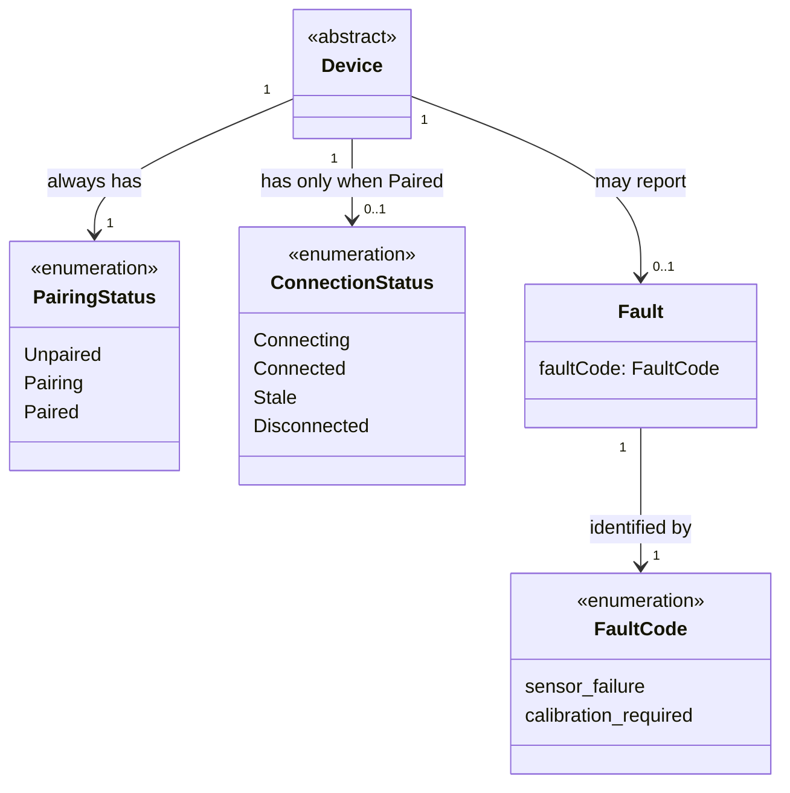

# Relationships and Cardinality

## Introduction

This document shows how the terms in the [Ubiquitous Language](./ubiquitous-language.md) connect to each other, and **how many** of each thing can sit on each side of a connection. That "how many" is called **cardinality**.

The diagrams use [Mermaid](https://mermaid.js.org/), which GitHub and most Markdown previews render automatically. Entity names are written in PascalCase (`SpaceType`), the same way they will appear as TypeScript types. They mean exactly the glossary term (`SpaceType` = **Space Type**).

## Table of contents

[How to read the diagrams](#how-to-read-the-diagrams)

[The whole model](#the-whole-model)

[Where things are](#where-things-are)

[How is tracked](#how-is-tracked)

[What is tracked](#what-is-tracked)

[Device Status](#device-status)

[Cardinality summary](#cardinality-summary)

[Rules the diagrams can't show](#rules-the-diagrams-cant-show)

[Aggregates](#aggregates)

[Open questions](#open-questions)

## How to read the diagrams

Each line connects two entities. The symbol at each **end** of the line says how many of the entity **at that end** take part.

| Symbol | Meaning | Read it as |
| --- | --- | --- |
| `\|\|` | exactly one | "one and only one" |
| `o\|` / `\|o` | zero or one | "optional, at most one" |
| `\|{` / `}\|` | one or more | "at least one" |
| `o{` / `}o` | zero or more | "any number, maybe none" |

Example: `Site ||--o{ Space : contains` reads in both directions:

- One **Site** contains **zero or more** Spaces.
- Each **Space** belongs to **exactly one** Site.

Where Mermaid can't express a rule (for example "exactly 4"), the rule is written under the diagram.

## The whole model

The full picture, without Device Status. Each section below zooms into one part.

## Where things are

The location hierarchy: Site → (Floor) → Space.

- One **Account** owns zero or more **Sites**. Each Site belongs to exactly one Account.
- One **Site** contains zero or more **Spaces**. Each Space belongs to exactly one Site.
- **Floors** are optional. A Site has zero or more Floors, and a Space sits on zero or one Floor.
- Every **Space** has exactly one **Space Type** (use `Other` when nothing fits). One Space Type is used by many Spaces.

## How is tracked

Devices (Hub and Module), the Sensors inside Modules, and the Assets that Sensors watch.

- A **Space** is home to zero or more **Hubs**. A Hub is in zero or one Space: it has no Space until it is Paired and placed.
- A **Hub** has exactly **4 Slots** (Slot 1 to Slot 4). A Slot always belongs to exactly one Hub.
- A **Slot** holds zero or one **Module**. A Module is in zero or one Slot (zero when it is not snapped in).
- A **Module** has no Space of its own. Its Space is always its Hub's Space.
- Every **Module** has exactly one **Module Type**, and the Module Type decides which **Sensors** it contains (at least one).
- A **Sensor** belongs to exactly one Module.
- A **Space** contains zero or more **Assets**. Each Asset is in exactly one Space and has exactly one **Asset Type**.
- An **Asset** is watched by one or more **Sensors**. A Sensor watches zero or one Asset: zero means it measures the Space itself (room air).

### Device is the parent of Hub and Module

Entity diagrams can't show "is a kind of", so this part uses a class diagram. The hollow arrow means "is a kind of".

- A **Sensor is not a Device**. It has no Device Status and is never paired on its own.
- An **Asset is not a Device**. It isn't connected and has no Device Status.
- The filled diamond (`*--`) means "is made of": when a Hub is removed, its Slots go with it; when a Module is removed, its Sensors go with it.

## What is tracked

Metrics, Units and the Readings Sensors produce.

- A **Sensor** measures exactly one **Metric**. One Metric can be measured by many Sensors.
- Each **Metric** has exactly one canonical **Unit** in the API. A Unit can be canonical for several Metrics (for example `µg/m³` for PM2.5 and PM10) or for none (a display-only Unit like `°F`).
- A **Sensor** produces zero or more **Readings**. Each Reading comes from exactly one Sensor and records exactly one Metric.
- Each **Reading** has exactly one **Subject**: either a Space or an Asset. The diagram shows both links as optional; the rule "exactly one of the two" is in [Rules the diagrams can't show](#rules-the-diagrams-cant-show).

## Device Status

Device Status is three separate fields. The cardinality shows the key rule: a Device **always** has a Pairing Status, but has a Connection Status **only when Paired**.

- **Pairing Status**: exactly one, always.
- **Connection Status**: zero or one. It exists only when Pairing Status is `Paired`.
- **Fault**: zero or one ("None, or a specific Fault"). It is independent of Connection Status, so a Device can be `Connected` and have a Fault.
- Each **Fault** has exactly one **Fault Code**.

## Cardinality summary

| From | Relationship | To | From side | To side |
| --- | --- | --- | --- | --- |
| Account | owns | Site | 1 | 0..* |
| Site | contains | Space | 1 | 0..* |
| Site | is split into | Floor | 1 | 0..* |
| Floor | groups | Space | 0..1 | 0..* |
| Space Type | categorises | Space | 1 | 0..* |
| Space | is home to | Hub | 0..1 | 0..* |
| Hub | has | Slot | 1 | exactly 4 |
| Slot | holds | Module | 0..1 | 0..1 |
| Module Type | defines | Module | 1 | 0..* |
| Module | contains | Sensor | 1 | 1..* |
| Space | contains | Asset | 1 | 0..* |
| Asset Type | categorises | Asset | 1 | 0..* |
| Asset | is watched by | Sensor | 0..1 | 1..* |
| Metric | is measured by | Sensor | 1 | 0..* |
| Unit | is canonical for | Metric | 1 | 0..* |
| Sensor | produces | Reading | 1 | 0..* |
| Metric | is recorded in | Reading | 1 | 0..* |
| Subject (Space or Asset) | is the Subject of | Reading | 1 | 0..* |
| Device | has | Pairing Status | 1 | 1 |
| Device | has | Connection Status | 1 | 0..1 (only when Paired) |
| Device | may report | Fault | 1 | 0..1 |
| Fault | identified by | Fault Code | 1 | 1 |

## Rules the diagrams can't show

These are **invariants**: rules that must always be true. The code (types, API validation, backend) has to enforce them.

1. **A Hub has exactly 4 Slots.**
2. **A Module's Space is its Hub's Space.** A Module never stores its own Space.
3. **A Sensor's Metric is fixed by its Module Type.** The user can't change it.
4. **A Sensor can only watch an Asset in its own Space.** The Asset's Space must equal the Space of the Sensor's Hub.
5. **A Reading has exactly one Subject.** If its Sensor watches an Asset, the Subject is that Asset; otherwise it is the Sensor's Space.
6. **A Reading never changes once recorded.** Its Sensor, Metric, value, Unit and time are fixed.
7. **A Reading is stored in its Metric's canonical Unit.** Other Units are only for display.
8. **Connection Status exists only when Pairing Status is `Paired`.**
9. **A Floor and its Spaces belong to the same Site.**
10. **A Hub gets a Space only after it is Paired.** An Unpaired or Pairing Hub has no Space.

## Aggregates

In Domain-Driven Design an **aggregate** is a group of things that are always changed together, through one "root" entity. Other parts of the system point at the root by its ID and never reach inside.

| Aggregate | Root | Contains | Points to (by ID) |
| --- | --- | --- | --- |
| **Site** | Site | Floors, Spaces, Assets | Account, Space Type, Asset Type |
| **Hub** | Hub | Slots, Modules, Sensors, Device Status | Space, Module Type, Metric, Asset |
| **Reading** | Reading | (nothing; it's a single fact) | Sensor, Metric, Subject |

**Reference data** never changes during normal use and is shared by everyone: Space Type, Asset Type, Module Type, Metric, Unit, Device Kind, Fault Code.

Why Readings are their own aggregate: there are millions of them and they never change, so they shouldn't be loaded every time someone renames a Hub.

## Open questions

- **Account** isn't defined in the Ubiquitous Language yet. Add it (and decide whether Sites can later be shared with other people).
- The glossary says an Asset is watched by **one or more** Sensors. What happens to an Asset when its last Sensor is removed: is it deleted, or is `0..*` allowed?
- The glossary allows **one** Fault per Device ("None, or a specific Fault"). Could a Device report several Faults at once?
- Can a **Module** move to another Hub? If yes, decide whether it keeps its Readings history and needs to pair again.
