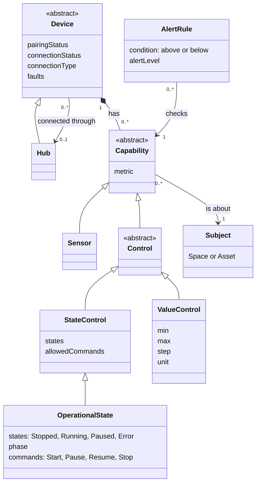
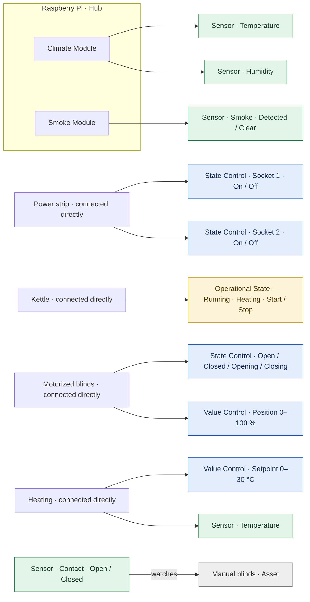
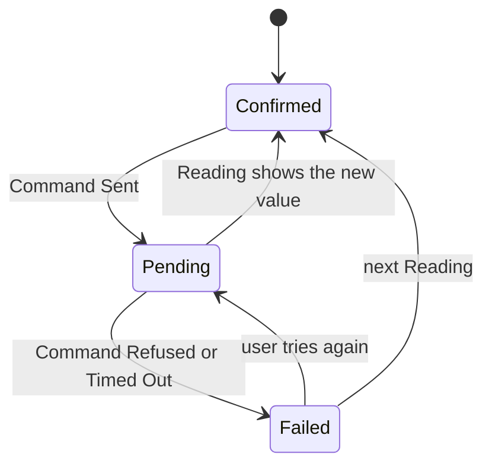
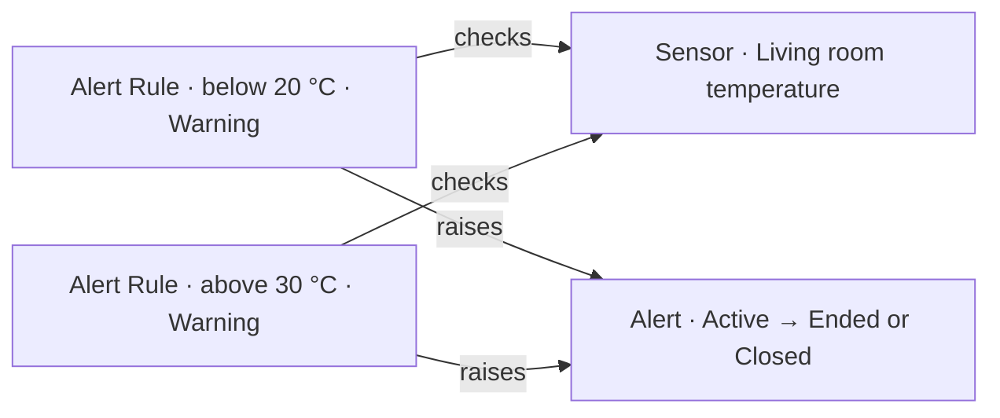

# Domain model review: beyond the Raspberry Pi

Status: decisions made (1–23), waiting for the owner's review. Recorded in [ADR 0002](adr/0002-devices-and-capabilities.md) (proposed). The Domain Model pages on the docs site haven't changed yet.

You're right: the current model only fits the Raspberry Pi setup. Most of what's needed is a gap, not a small tweak. One change to the original proposal: splitting devices into "hub" and "solo" isn't quite the right line (see [Your examples against the model](#your-examples-against-the-model)).

## At a glance

Four diagrams that sum up the review, using the working names and [Decisions](#decisions) 1–10. Nothing here is in the Domain Model pages yet.

### 1. Proposed structure

A Device has Capabilities. Each Capability is either a Sensor (only reports) or a Control (reports and can be changed). A Device connects through a Hub or directly, over any Connection Type (wire, Wi-Fi, Zigbee…). The hollow arrow means "is a kind of".



- A Device connected through a Hub is what we call a **Module** today. A Device with no Hub is **connected directly**.
- **Connection Type** (Wired, Wi-Fi, Zigbee, Thread, Bluetooth) is information only (decision 12). A Module can be plugged into the Hub or talk to it wirelessly; the rules are the same.
- **Allowed commands** (decision 1) live on each State Control: one kettle allows only `Stop`, a power strip socket allows `Turn on` and `Turn off`.
- **Power or Operational State** (decision 14): a Device that runs a task (kettle, washing machine) is controlled through Operational State. It has a Power Control only if the real device has a separate power button. When Power is Off, Operational State is Stopped and Start isn't allowed.
- **Operational State** is a special State Control (decision 11): it reports what the Device is doing and lets the user **Start, Pause, Resume and Stop** it. Each Device lists which of these commands it allows, like any State Control. A Device has at most one.
- **Operational State Error** can't be chosen by the user: the Device reports it, with an **Error reason**, when it can't do its task. Error and Fault are separate, but linked when a Fault causes the Error (decision 10). **Phase** (Heating, Keeping warm) is also reported only.
- An **Alert Rule** checks one Capability, above **or** below a value (decision 7).

### 2. The examples in the new model

Green = Sensor (only reports), blue = Control (can be changed), yellow = Operational State, grey = Asset (not connected).



### 3. What happens when the user changes a Control

A Device doesn't change instantly, so every Control has a **pending** step. These are the extra UI states Control components need (decision 5). The same steps apply to Start, Pause, Resume and Stop (decision 11). Commands the Control doesn't allow aren't offered, and Accounts the Site is shared with see the Control disabled.



### 4. A comfort range is two Alert Rules

Decision 7: "below 20 °C" and "above 30 °C" are two separate rules on the same Sensor, because sometimes only one side is needed. The app's developer defines them in code, and the UI shows them (decision 4).



## Example devices and their Capabilities

Each example device described in the proposed model: how it connects, what it reports and what the user can change. Working names from the [Naming comparison](#naming-comparison). Every connected Device also has the usual Device Status (Pairing Status, Connection Status, Fault); it isn't repeated in each table.

How to read the tables:

- **Kind**: Sensor (only reports), State Control (pick one of its States) or Value Control (set a number in a range).
- **Values**: the States, or the range and Unit, the Capability reports.
- **Allowed commands**: what the user can send. "–" means read-only.
- **Subject**: what the Capability is about, the Space or an Asset.

### Raspberry Pi (Hub)

A small computer running the DeTriz Hub software. Modules connect through it, by wire or wirelessly. It connects to the network over Wi-Fi and is placed in a Space.

- **Connects:** directly. Other Devices (Modules) connect through it.
- **Capabilities:** none of its own today. It only passes on its Modules' Readings.
- **Operational State:** none.

### Climate Module

A sensor board connected to the Raspberry Pi.

- **Connects:** through a Hub. Connection Type: Wired (plugged into the Pi) or wireless (for example Zigbee or Wi-Fi).

| Capability  | Kind   | Values      | Allowed commands | Subject | Example Alert Rules                              |
| ----------- | ------ | ----------- | ---------------- | ------- | ------------------------------------------------ |
| Temperature | Sensor | Number, °C  | –                | Space   | "below 20 °C" (Warning), "above 30 °C" (Warning) |
| Humidity    | Sensor | Number, %RH | –                | Space   | "above 70 %RH" (Info)                            |

### Smoke Module

A smoke detector board connected to the Raspberry Pi.

- **Connects:** through a Hub. Connection Type: Wired or wireless, as for the Climate Module.

| Capability | Kind   | Values          | Allowed commands | Subject | Example Alert Rules                   |
| ---------- | ------ | --------------- | ---------------- | ------- | ------------------------------------- |
| Smoke      | Sensor | Detected, Clear | –                | Space   | Built-in: "Smoke Detected" (Critical) |

### Power strip

A surge protector strip with several sockets. Each socket is switched on its own, so each one is a separate Capability on the same Device.

- **Connects:** directly.
- **Operational State:** none.

| Capability | Kind          | Values  | Allowed commands  | Subject                                | Example Alert Rules |
| ---------- | ------------- | ------- | ----------------- | -------------------------------------- | ------------------- |
| Socket 1   | State Control | On, Off | Turn on, Turn off | Asset plugged into it (e.g. Desk lamp) | –                   |
| Socket 2   | State Control | On, Off | Turn on, Turn off | Asset plugged into it (e.g. Monitor)   | –                   |
| Socket 3–n | State Control | On, Off | Turn on, Turn off | Asset plugged into it                  | –                   |

### Kettle

A connected kettle. It runs a task (heating), and the real kettle has one switch, so it's controlled through **Operational State** only, with no Power Control (decision 14). What the user can change depends on the model (decision 1), so the allowed commands differ:

| Kettle variant             | Capability        | Values                                          | Allowed commands |
| -------------------------- | ----------------- | ----------------------------------------------- | ---------------- |
| Shows status only          | Operational State | Stopped, Running (Heating, Keeping warm), Error | –                |
| Can only be stopped        | Operational State | Stopped, Running (Heating, Keeping warm), Error | Stop             |
| Can be started and stopped | Operational State | Stopped, Running (Heating, Keeping warm), Error | Start, Stop      |

All variants:

- **Connects:** directly.
- **Subject:** the Kitchen Space.
- **Error** when it can't heat, with an Error reason (decision 13): "No water" (device-specific reason, no Fault) or "Unable to start" caused by Fault `sensor_failure` (decision 10).
- Kettles usually can't Pause.
- **Example Alert Rule:** "Kettle Running" (Info).

### Washing machine (for comparison)

Not in the original examples, but it shows when a Device has **both** Controls: the real machine has a power button **and** a Start/Pause button (decision 14).

| Capability        | Kind                              | Values                                                       | Allowed commands           |
| ----------------- | --------------------------------- | ------------------------------------------------------------ | -------------------------- |
| Power             | State Control                     | On, Off                                                      | Turn on, Turn off          |
| Operational State | State Control (Operational State) | Stopped, Running (Washing, Rinsing, Spinning), Paused, Error | Start, Pause, Resume, Stop |

- **Rule:** when Power is Off, Operational State is Stopped and Start isn't allowed.
- **Error reason example:** "Door open" (device-specific).

### Motorized blinds

Smart roller blinds or curtains with a motor. Two variants in the MVP (decision 9).

- **Connects:** directly.
- **Subject:** the Window Asset they cover.
- **Operational State:** none. Opening and Closing are States of the blinds themselves.

| Variant                          | Capability   | Kind          | Values                         | Allowed commands  |
| -------------------------------- | ------------ | ------------- | ------------------------------ | ----------------- |
| B. Open / Closed only            | Open / Close | State Control | Open, Closed, Opening, Closing | Open, Close, Stop |
| C. With position (adds to B)     | Position     | Value Control | 0–100 %, step 1                | Set position      |
| D. With tilt (later, not in MVP) | Tilt         | Value Control | 0–100 %                        | Set tilt          |

The Capability is called **Open / Close** (decision 21), as in Google Home.

### Manual blinds

Ordinary blinds pulled by hand (case A). Not connected, so not a Device.

- **In the model:** an **Asset** (Asset Type Window) in a Space. No Device Status, no Capabilities of its own.
- **Optional:** a Contact Sensor on a Module watches it:

| Capability | Kind   | Values       | Allowed commands | Subject            | Example Alert Rules  |
| ---------- | ------ | ------------ | ---------------- | ------------------ | -------------------- |
| Contact    | Sensor | Open, Closed | –                | The blinds (Asset) | "Blinds Open" (Info) |

### Heating (thermostat)

A heating controller where the user sets the wanted temperature. It has two numbers: the one you set and the one it measures.

- **Connects:** directly.
- **Subject:** the Space it heats.
- **Operational State:** Stopped, or Running with Phase **Heating**. Error when it can't heat. A Fault such as `calibration_required` doesn't have to stop it: it can stay Running (decision 10). No allowed commands: the user controls heating through Setpoint and Mode, as on every platform.

| Capability  | Kind          | Values                       | Allowed commands | Example Alert Rules     |
| ----------- | ------------- | ---------------------------- | ---------------- | ----------------------- |
| Setpoint    | Value Control | 0–30 °C, step 0.5            | Set setpoint     | –                       |
| Temperature | Sensor        | Number, °C                   | –                | "below 18 °C" (Warning) |
| Mode        | State Control | Off, Heat (Cool, Auto later) | Set mode         | –                       |

Mode is in the MVP with Off and Heat (decision 22), so the user can turn heating off. Cool and Auto can be added later without changing the model.

### Summary

| Device           | Connects       | Sensors               | State Controls | Value Controls | Operational State               |
| ---------------- | -------------- | --------------------- | -------------- | -------------- | ------------------------------- |
| Raspberry Pi     | Directly (Hub) | –                     | –              | –              | –                               |
| Climate Module   | Through a Hub  | Temperature, Humidity | –              | –              | –                               |
| Smoke Module     | Through a Hub  | Smoke                 | –              | –              | –                               |
| Power strip      | Directly       | –                     | Socket 1–n     | –              | –                               |
| Kettle           | Directly       | –                     | –              | –              | ✅ (Start / Stop per variant)   |
| Washing machine  | Directly       | –                     | Power          | –              | ✅ (Start, Pause, Resume, Stop) |
| Motorized blinds | Directly       | –                     | Open / Close   | Position (C)   | –                               |
| Manual blinds    | Asset          | Contact (on a Module) | –              | –              | –                               |
| Heating          | Directly       | Temperature           | Mode           | Setpoint       | ✅                              |

## What the current model assumes

Based on the Glossary, Data model, Device lifecycle and Events and commands pages (`kit/apps/docs-site/docs/domain-model/`). Five assumptions are built in:

1. **A Device is either a Hub or a Module.** Every Sensor sits on a Module, and every Module is wired to a Hub. A device that connects by itself has no place in the model.
2. **It is read-only.** Devices only report Readings. The only commands are for managing devices and alerts (Pair, Dismiss, Remove, Place Hub, Close Alert). There is no command like "turn on" or "set to 22 °C".
3. **Every State Metric has exactly two States.** The kettle has three (Standby, Off, On), so it doesn't fit.
4. **Alert Rules are written by the app's developer in code.** Each rule checks "above **or** below" one value. "Below 20 **or** above 30" can't be expressed, and an end user can't create a rule.
5. **Only Modules can be Stale,** because only Modules send Readings.

## Your examples against the model

| Example                | What it really is                                             | Does it fit today?                   |
| ---------------------- | ------------------------------------------------------------- | ------------------------------------ |
| Raspberry Pi + modules | Hub → Modules → Sensors, read-only                            | ✅                                   |
| Smoke sensor           | Read-only, Detected/Clear                                     | ✅ (but only as a Module on a Hub)   |
| Window blinds          | Standalone device that can be opened and closed               | ❌ no standalone devices, no control |
| Kettle                 | Standalone device with 3 States, only some changes allowed    | ❌ 3 States, partial control         |
| Surge protector strip  | **One device with several sockets, each switched on its own** | ❌                                   |
| Heating 0–30 °C        | Device where you set a value in a range                       | ❌ no setting values                 |

The power strip is the reason to avoid a plain "hub vs solo" split. It's one device that connects by itself (so "solo"), but it has 4–6 sockets you control separately (so it's not one thing). The real split is along two separate questions:

- **How does it connect?** By itself, or through a Hub.
- **What can it do?** Each device has one or more Capabilities. Each Capability either only reports, or reports and can be changed.

Big platforms model it the same way: Home Assistant (Device → Entities), Matter (Node → Endpoints) and SmartThings (Device → Capabilities).

## Proposed model (draft names)

```
Device ── has 1..* ── Capability ── about ── Space or Asset
  │                      ├─ Sensor        (report only)          smoke, temperature
  │                      └─ Control       (report + change)
  │                           ├─ State Control  (pick a State)   socket On/Off, kettle, blinds
  │                           └─ Value Control  (min/max/step)   heating 0–30 °C
  └─ connects through 0..1 Hub
       Device Kind: Hub | Module (through a Hub) | Standalone Device
```

The four behaviours map onto it like this:

1. **Show status only** → a Sensor, as today.
2. **Change state** → a State Control. Each Control lists the commands it allows, so "can turn Off but not On" is just a list with Off and no On.
3. **Alert on a condition** → this isn't a device capability. It's an Alert Rule on top of any Capability that reports something. It needs a new "outside the range 20–30" condition, plus a decision on whether end users can create rules.
4. **Change a value** → a Value Control with min, max, step and Unit.

## Changes this would ripple into

- **Rename "Two-state Metric" to "State Metric"** with 2 or more States, so the kettle fits.
- **Requested vs. reported value.** When you tap "On", the device doesn't change instantly. We need a pending step (Command Sent → Confirmed / Failed / Timed out), and the UI needs a "pending" state for every Control component.
- **Heating has two numbers:** the target you set (Value Control, 22 °C) and the measured temperature (Sensor, 19.8 °C).
- **Stale:** any device that sends Readings can be Stale, not only Modules.
- **Pairing a Standalone Device:** today pairing relies on the Hub Token, so Standalone Devices need their own way to pair.
- **Sharing:** shared Accounts are view-only, so they can't control devices. This matches the current rules, but should be written down.

## Naming research

How the big smart home platforms (Matter, Google Home, Home Assistant, SmartThings) and EU energy rules name things. Some sources were SDK docs or third-party pages, and some points come from memory (marked below). Check the official Matter spec and Google's traits page before locking names in the Glossary.

### On / Off / Standby

- **All four platforms use On / Off** as the basic power pair: the Matter On/Off cluster, the Google `OnOff` trait, the Home Assistant `switch` and the SmartThings `switch`. Commands: Turn on, Turn off, sometimes Toggle.
- **"Standby" is an energy-regulation term**, not a smart home State. EU rules define:
  - **Off mode:** plugged in, but doing nothing.
  - **Standby mode:** waiting, and can be woken up.
  - **Networked standby:** waiting, and still reachable over the network.
  - **Active mode:** at least one main function is running.
- A connected kettle sitting idle is technically in networked standby. For the user it's simply **Off**, but still reachable.

The kettle's three states mix three different questions:

| Question                    | Values                                            | Where it belongs in our model            |
| --------------------------- | ------------------------------------------------- | ---------------------------------------- |
| Is the power on?            | On / Off                                          | A State Control                          |
| What is it doing right now? | Stopped / Running (Heating, Keeping warm) / Error | A separate Operational State (see below) |
| Can we reach it?            | Connected / Disconnected                          | Our existing **Connection Status**       |

"Power down" (fully unplugged) isn't a State: the device can't be reached, so it is **Disconnected**.

### What a device is doing (Operational State)

- Matter's **Operational State** cluster has the basic states **Stopped, Running, Paused, Error**. Appliance types add their own (a robot vacuum adds Docked and Charging).
- Google's matching trait is `StartStop`, with the commands Start, Stop, Pause and Resume.
- A good pattern for kettles, washing machines and similar appliances. It also shows State lists can have more than 2 values, which supports renaming "Two-state Metric" to "State Metric".

### Blinds and other things that open

- Matter: **Window Covering** cluster ("Lift" = how far it opens, "Tilt" = slat angle).
- Google: `OpenClose` trait with an open percentage. Home Assistant: **cover**, with a position from 0 to 100. SmartThings: `windowShade` and `windowShadeLevel`.
- From memory: the states are usually **Open, Closed, Opening, Closing**, and the commands **Open, Close, Stop, Set position**.

### Heating

- Everyone separates the **current temperature** (measured) from the **setpoint** or **target temperature** (wanted). SmartThings: `thermostatHeatingSetpoint` next to `temperatureMeasurement`. Google: `TemperatureSetting` (a temperature point plus modes).
- From memory: modes are usually **Off, Heat, Cool, Auto**.
- Matches the proposal: heating = a Value Control (setpoint) + a Sensor (measured temperature).

### Detectors

- From memory: Home Assistant shows smoke, motion and similar binary sensors as **Detected / Clear**, which is our wording already. Matter uses **Occupied / Unoccupied** for presence. Keep Detected / Clear.

### Naming the structure (Device → its parts)

| Platform       | Device | One controllable or readable part  | What it can do                  |
| -------------- | ------ | ---------------------------------- | ------------------------------- |
| Matter         | Node   | Endpoint (e.g. socket 1, socket 2) | Cluster (On/Off, Thermostat…)   |
| Google Home    | Device | –                                  | Trait                           |
| Home Assistant | Device | Entity                             | Domain (switch, cover, climate) |
| SmartThings    | Device | Component (main, outlet1…)         | Capability                      |

A power strip in Matter is **one device with one Endpoint per socket**, each with its own On/Off. That's exactly our power strip case.

### Suggested names for our Glossary

| Our term                                                                                     | Matches                              |
| -------------------------------------------------------------------------------------------- | ------------------------------------ |
| **Capability** (one thing a Device reports or does)                                          | SmartThings Capability, Google Trait |
| **On / Off** (not Standby / Power down)                                                      | All four platforms                   |
| **Operational State**: Stopped, Running, Paused, Error (+ Phase)                             | Matter Operational State             |
| **Open / Closed / Opening / Closing** + **Position %**                                       | Matter, Google, Home Assistant       |
| **Setpoint** (or "Target temperature" in UI copy) vs. **Temperature**                        | All four platforms                   |
| **Detected / Clear**                                                                         | Home Assistant (already ours)        |
| Commands: **Turn on, Turn off, Open, Close, Stop, Set position, Set setpoint, Start, Pause** | Google and Matter command names      |

### Sources

- [Google: Matter clusters → Google traits](https://developers.home.google.com/matter/clusters)
- [Matter device types (Build with Matter handbook)](https://handbook.buildwithmatter.com/how-it-works/device-types/)
- [Matter cluster list (connectedhomeip)](https://project-chip.github.io/connectedhomeip-doc/examples/all-devices-app/docs/supported_clusters.html)
- [Google Home cloud-to-cloud traits](https://developers.home.google.com/cloud-to-cloud/traits)
- [Home Assistant entity platforms](https://www.mintlify.com/home-assistant/core/integrations/entity-platforms)
- [Home Assistant SmartThings integration (capability mapping)](https://www.home-assistant.io/components/smartthings)
- [SmartThings Home API reference](https://developer.smartthings.com/docs/home-api/home-api-reference)
- [Matter Operational State cluster (matter-js)](https://matter-js.github.io/docs/interfaces/_project_chip_matter_js.cluster.OperationalState.Cluster.html)
- [SmartThings: Matter OperationalState](https://developer.smartthings.com/docs/edge-device-drivers/matter/generated/clusters/OperationalState.html)
- [EU Regulation 2023/826 (standby / off mode)](https://eur-lex.europa.eu/eli/reg/2023/826/oj/eng)
- [European Commission: standby and networked standby FAQ](https://energy-efficient-products.ec.europa.eu/faqs/product-faqs/standby-and-networked-standby-mode-faqs_is)

## Decisions

Answers to the open questions from the first review round.

| #   | Question                            | Decision                                                                                                                                                                                                                                                                                                                                                                                                                                                                                                                                                                                                    |
| --- | ----------------------------------- | ----------------------------------------------------------------------------------------------------------------------------------------------------------------------------------------------------------------------------------------------------------------------------------------------------------------------------------------------------------------------------------------------------------------------------------------------------------------------------------------------------------------------------------------------------------------------------------------------------------- |
| 1   | Kettle                              | **It depends on the device's capabilities.** Some devices only show whether they are working, some can only be turned off remotely, and some can be turned on and off. The model can't assume one behaviour per device type: each Control lists the commands it allows.                                                                                                                                                                                                                                                                                                                                     |
| 2   | Blinds                              | See decision 9.                                                                                                                                                                                                                                                                                                                                                                                                                                                                                                                                                                                             |
| 3   | Standby / power down / off          | **Align with industry conventions as much as possible.** Accept the proposal from [Naming research](#on--off--standby): On / Off for power, Operational State for what the device is doing, "power down" = Disconnected.                                                                                                                                                                                                                                                                                                                                                                                    |
| 4   | Who creates Alert Rules             | **The app's developer defines them in code for now, but the UI must be able to show them.** Today the Glossary says an app "may show them, but doesn't have to"; the kit should now give components to display rules (condition, Alert Level, on/off).                                                                                                                                                                                                                                                                                                                                                      |
| 5   | Scope                               | **Add Controls to the MVP.**                                                                                                                                                                                                                                                                                                                                                                                                                                                                                                                                                                                |
| 6   | Naming                              | **Align with industry; needs more work.** Capability / Sensor / Control / Standalone Device are working names only.                                                                                                                                                                                                                                                                                                                                                                                                                                                                                         |
| 7   | Range condition for Alert Rules     | **Two rules**, not one range rule. Some cases only need one side (only "above 28 °C"), so "below 20" and "above 30" are two separate Alert Rules. The current condition ("above **or** below a value") stays as it is.                                                                                                                                                                                                                                                                                                                                                                                      |
| 8   | Operational State in the MVP        | **Yes.** The MVP shows Operational State as well as On / Off.                                                                                                                                                                                                                                                                                                                                                                                                                                                                                                                                               |
| 9   | Blinds                              | **Support cases A, B and C in the MVP** (manual blinds as an Asset, motorized Open/Closed, motorized with Position). Tilt (case D) later.                                                                                                                                                                                                                                                                                                                                                                                                                                                                   |
| 10  | Operational State vs. Fault         | **Option C: independent, but linked.** Fault answers "is the hardware healthy?"; Operational State Error answers "can it do its task right now?". Error has its own **Error reason** (following Matter). When a Fault causes the Error, the reason points to that Fault Code and the UI shows **one** message, not two. Examples: kettle with no water = Error, no Fault; broken temperature sensor = Fault + Error; thermostat needing calibration = Fault, still Running. (Replaces the earlier draft "Error is shown whenever there's a Fault", which couldn't show "No water".)                         |
| 11  | Start, Pause, Stop                  | **Users can Start, Pause, Resume and Stop a Device from the UI.** Operational State becomes a special State Control: same allowed-commands list and same pending step as other Controls.                                                                                                                                                                                                                                                                                                                                                                                                                    |
| 12  | Wired or wireless Modules           | **A Module doesn't have to be plugged into the Hub.** It can connect to the Hub by wire, Wi-Fi, Zigbee, Bluetooth, Thread or anything else. What matters is "through a Hub" or "directly", not the radio or cable. An optional **Connection Type** field records how, for display and troubleshooting only.                                                                                                                                                                                                                                                                                                 |
| 13  | Error reasons                       | **Option C: a fixed base list plus device-specific reasons** (as in Matter). The kit defines a small list of general reasons (Unable to start or resume, Unable to complete, Command not valid in this state). A device can also send its own reason with a label (`no_water`, "No water"). The UI shows a tailored message for reasons it knows and falls back to the label for the rest. Later, Fault Codes could work the same way.                                                                                                                                                                      |
| 14  | Power vs. Start                     | **Option A: copy the real device's buttons.** A Device that runs a task (kettle, washing machine) is controlled through **Operational State** (Start, Pause, Resume, Stop). It gets a **Power** Control (On / Off) only if the real device has a separate power button. When Power is Off, Operational State is Stopped and Start isn't allowed. Follows Matter, where On/Off is optional for appliances.                                                                                                                                                                                                   |
| 15  | Pairing a wireless Module           | **Option A: both ways, same lifecycle.** Wired Modules are listed in the Hub's settings, as today. Wireless Modules are found by a new **Start Search** command: the Hub listens for a limited time, and each new Module it hears raises **Device Detected**. New events **Search Started** and **Search Ended**. After that, nothing changes: Unpaired → Pairing → Paired. A Matter-style setup code (QR code) can be added later. UI: a new **Searching** pattern (searching with countdown, devices found, nothing found); pairing screens aren't in the MVP, so it can be built later.                  |
| 16  | Pairing a Device connected directly | **Option A: the Hub Token becomes a Device Token**, used by every Device connected directly (a Hub is one of them). The user creates it in their Account and enters it in the Device's setup; the Device sends it, and the API raises **Device Detected**. Same lifecycle as today. A Device connected directly belongs to the Account from the moment it's detected (like Data model rule 16). **Place Hub** becomes **Place Device**; Modules still take their Hub's Space. Setup codes (QR, Matter) and account linking with manufacturers' clouds can be added later: they also end in Device Detected. |
| 17  | Why a Device disconnected           | **Only Disconnected, as today.** No reason field and no "likely cause" hint: a silent device can't say why, so most reasons would be guesses. The only certain case (the Hub is offline) is already covered by Device lifecycle rule 4 ("If a Hub is Disconnected, all its Modules are Disconnected"). Matches Google Home ("Offline"), Apple Home ("No Response") and Home Assistant ("Unavailable").                                                                                                                                                                                                      |
| 18  | Battery level                       | **An ordinary Sensor.** New Measured Metric **Battery** (Unit %). Only devices with a battery have it. "Battery below 15 %" is a normal Alert Rule. Device Status stays at three fields. Matches SmartThings (`battery`) and Matter (Power Source).                                                                                                                                                                                                                                                                                                                                                         |
| 19  | Connection Type values              | **Wired, Wi-Fi, Zigbee, Thread, Bluetooth, Other.** Optional, display only, no rules depend on it. Can be dropped from the MVP if no screen needs it.                                                                                                                                                                                                                                                                                                                                                                                                                                                       |
| 20  | Final names (part 1)                | **Accepted:** Capability (one thing a Device reports or does), Sensor (only reports), State Control (pick a State), Value Control (set a number), Module (a Device connected through a Hub). UI copy uses the specific name ("Power", "Setpoint", "Position"). Still to pick: the name for a Device connected directly, and for the Open / Closed Capability.                                                                                                                                                                                                                                               |
| 21  | Final names (part 2)                | **Standalone Device** for a Device connected directly (third Device Kind: Hub, Module, Standalone Device). **Open / Close** for the Capability of blinds, garage doors, gates and valves (as Google Home's `OpenClose`). The Contact Sensor stays for read-only Open / Closed.                                                                                                                                                                                                                                                                                                                              |
| 22  | Heating Mode                        | **In the MVP, with Off and Heat only.** An ordinary State Control called **Mode**, so the user can turn heating off. Cool and Auto later. Follows every platform (Matter SystemMode, Google TemperatureSetting, Home Assistant HVAC mode). UI: a generic "pick one of a few" component (working name `StateSelectControl`), reusable for fan speed or washing programmes.                                                                                                                                                                                                                                   |
| 23  | Device Type                         | **One Device Type list for every Device, replacing Module Type** (as Matter and Google Home do). Values: Hub, Climate, Light, Air Quality, Motion, Contact, Power, Smoke, CO, Kettle, Power strip, Blinds, Thermostat, Washing machine, Other. Used for the icon and the default name. **Module Name** becomes **Device Name** (starts as the Device Type name, the user can rename it). The Glossary must explain **Device Kind** (how it connects: Hub, Module, Standalone Device) vs. **Device Type** (what it is).                                                                                      |
| 24  | One card for every Device           | **Rename `ModuleCard` to `DeviceCard`** and extend it to show Sensors, Controls and Operational State for any Device. One card instead of two (keep it simple).                                                                                                                                                                                                                                                                                                                                                                                                                                             |
| 25  | Power Control and Switch            | **`PowerControl` wraps the existing `Switch`** and adds the pending, failed, allowed-commands and view-only states around it. `Switch` is no longer "app settings only".                                                                                                                                                                                                                                                                                                                                                                                                                                    |

### What the decisions mean

- **Keep it simple is a modelling principle too** (decision 17). When options are equal, pick the one that adds the fewest new concepts, fields and rules. Worth recording in the ADR next to industry alignment.
- **Industry alignment is now a modelling principle.** When we name a State, command or concept, we start from Matter, Google Home, Home Assistant and SmartThings and only invent our own term when none fits. Worth recording in the ADR.
- **Allowed commands per Control (decision 1).** A device's capability ranges from read-only (Sensor) to "Turn off only" to "Turn on and off". So the kettle case is not a special device type: it's an Operational State whose allowed commands are only `Stop` (decision 14).
- **Showing Alert Rules (decision 4).** Changes Glossary wording ("An app may show them, but doesn't have to"). A comfort range (below 20 **or** above 30) is two Alert Rules on the same Sensor (decision 7). The UI may group them visually, but the model has no range rule.
- **Operational State in the MVP (decisions 8 and 11).** Users can see it and Start, Pause, Resume or Stop the Device. Needs its own Glossary terms, commands (Start, Pause, Resume, Stop), events (Operational State Changed) and UI states. See [Naming comparison](#naming-comparison) for the proposed values.
- **Wired or wireless Modules (decision 12).** A Wi-Fi Module that talks to the Raspberry Pi is still a Module; a Wi-Fi kettle that talks to our API by itself is connected directly. Home Assistant and Matter also record the connection type as information, not as a separate kind of Device. The Domain Model pages say "wired" in several places (Glossary Hub and Module, Data model "has wired to it", Device lifecycle "Unplugging a Module", flow "unplugging and plugging back in", lifecycle rules 5 and 9): they become "connected through", and "unplugged" becomes "lost connection to its Hub".
- **Controls in the MVP (decision 5).** The roadmap (`docs/product-requirements/roadmap.md`) says the MVP only _shows_ data, so it needs updating. Control components need the target states plus a **pending** state (command sent, not yet confirmed) and a **refused / failed** state. Shared Accounts see Controls disabled (view-only).

## Still open

See Step 0 in [`domain-model-change-implementation.md`](product-requirements/domain-model-change-implementation.md#step-0-close-the-review) for what is left. The Domain Model pages stay unchanged until the review is done.

## Naming comparison

Working names for now ("let's go with that for now"). Each row compares our candidate name with the four platforms (plus Apple Home, from memory) and gives a recommendation. Rows marked _from memory_ weren't checked in the research above.

### 1. The part of a Device (one thing it reports or does)

| Platform       | Name                                                   |
| -------------- | ------------------------------------------------------ |
| Matter         | Endpoint (the instance) + Cluster (what it can do)     |
| Home Assistant | Entity                                                 |
| SmartThings    | Component (the instance) + Capability (what it can do) |
| Google Home    | Trait (what it can do), no instance name               |
| Apple Home     | Service + Characteristic (_from memory_)               |

**Recommendation: Capability.** It's plain English, a designer understands it without a definition, and SmartThings uses it. One difference to note: in SmartThings a Capability is a _type_ ("switch"), while ours is an _instance_ ("the switch on socket 2"). If we ever need the type, call it **Capability Type** (same pattern as Space Type, Asset Type).

### 2. Kinds of Capability

| Our candidate     | Matter                             | Home Assistant            | Google Home                             | Recommendation                                                                          |
| ----------------- | ---------------------------------- | ------------------------- | --------------------------------------- | --------------------------------------------------------------------------------------- |
| **Sensor**        | Measurement / sensor clusters      | `sensor`, `binary_sensor` | Sensor State trait                      | Keep. Already in the Glossary and used everywhere.                                      |
| **State Control** | On/Off, Mode Select                | `switch`, `select`        | OnOff, Modes, OpenClose                 | Keep as the model name. UI copy uses the specific name: Switch, Mode.                   |
| **Value Control** | Level Control, Thermostat setpoint | `number`                  | TemperatureSetting, OpenClose (percent) | Keep as the model name. UI copy uses the specific name: Setpoint, Position, Brightness. |

No platform has one generic name for "a control you set to a value", so we keep plain model names and use industry names in UI copy.

### 3. Device kinds

| Our candidate         | Matter                               | Home Assistant                | SmartThings / others                          | Recommendation                                                                                                                                         |
| --------------------- | ------------------------------------ | ----------------------------- | --------------------------------------------- | ------------------------------------------------------------------------------------------------------------------------------------------------------ |
| **Hub**               | Bridge                               | Hub / gateway device          | Hub; Philips Hue: Bridge; Zigbee: Coordinator | Keep **Hub**: the most common word for users.                                                                                                          |
| **Module**            | Bridged device                       | Device connected `via_device` | Zigbee/Z-Wave device behind a hub             | Keep **Module** for now, defined as "a Device connected through a Hub". Revisit when real non-Pi hubs appear.                                          |
| **Standalone Device** | No special name (just a device/node) | No special name               | No special name; often "Wi-Fi device"         | Use the relationship instead of a kind: a Device is **connected through a Hub** or **connected directly**. "Standalone" stays only as a working label. |

### 4. States and commands

| Area              | States                                                     | Commands                        | Source                                                       |
| ----------------- | ---------------------------------------------------------- | ------------------------------- | ------------------------------------------------------------ |
| Power             | On, Off                                                    | Turn on, Turn off, Toggle       | All four platforms                                           |
| Operational State | Stopped, Running, Paused, Error + device-specific          | Start, Stop, Pause, Resume      | Matter Operational State, Google StartStop                   |
| Openings          | Open, Closed, Opening, Closing (+ Position %)              | Open, Close, Stop, Set position | Matter Window Covering, Google OpenClose, HA cover           |
| Heating           | Current temperature + Setpoint; mode Off, Heat, Cool, Auto | Set setpoint, Set mode          | SmartThings, Google TemperatureSetting (modes _from memory_) |
| Detectors         | Detected, Clear                                            | none (read-only)                | Home Assistant (_from memory_)                               |

**Operational State for the kettle:** Matter's base values are Stopped, Running, Paused and Error, and it describes _what kind_ of running with a **Phase** (Heating, Keeping warm). Proposal: follow Matter. The kettle is **Running** with Phase **Heating** or **Keeping warm**, or **Stopped**. This replaces "Idle" from the earlier draft, because Matter uses Stopped.

## Next steps

1. Review this document (owner). The Domain Model pages stay unchanged until then.
2. Write an ADR in `docs/adr/` for the decision (including industry alignment as a principle).
3. Update the four Domain Model pages (Glossary, Data model, Device lifecycle, Events and commands) on branch `99-domain-model-update`.
4. Update the roadmap: Controls and Operational State (with Start, Pause, Resume, Stop) are part of the MVP.
