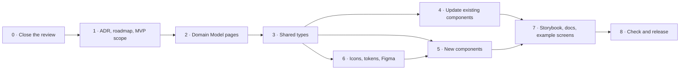

# Domain model change: implementation plan

Status: draft. Based on the decisions in [`docs/domain-model-revew.md`](../domain-model-revew.md) (decisions 1–12). Nothing has been changed yet.

This plan turns the review into work: first the decisions and docs, then the domain model pages, then the UI kit (types, existing components, new components, Figma, Storybook and docs).

## Contents

- [What changes, in one paragraph](#what-changes-in-one-paragraph)
- [Order of work](#order-of-work)
- [Step 0: Close the review](#step-0-close-the-review)
- [Step 1: Record the decision](#step-1-record-the-decision)
- [Step 2: Update the Domain Model pages](#step-2-update-the-domain-model-pages)
- [Step 3: Update shared types](#step-3-update-shared-types)
- [Step 4: Update existing components](#step-4-update-existing-components)
- [Step 5: Build new components](#step-5-build-new-components)
- [Step 6: Icons, tokens and Figma](#step-6-icons-tokens-and-figma)
- [Step 7: Storybook, docs site and example screens](#step-7-storybook-docs-site-and-example-screens)
- [Step 8: Check and release](#step-8-check-and-release)
- [Suggested pull requests](#suggested-pull-requests)

## What changes, in one paragraph

Today the model is a Raspberry Pi with wired Modules that only report. After the change: **everything you pair is a Device**. A **Hub** is a Device that other Devices (Modules) connect through, by wire or wirelessly. Other Devices connect **directly**. Each Device has **Capabilities**: a **Sensor** only reports, a **Control** reports and can be changed (**State Control**: pick a State; **Value Control**: set a number). **Operational State** (Stopped, Running, Paused, Error) is a special State Control with Start, Pause, Resume and Stop. Each Control lists its **allowed commands**. Every command goes through a **pending** step. Alert Rules are still defined in code, the UI shows them, and a range is two rules. Names follow industry conventions (Matter, Google Home, Home Assistant, SmartThings).

## Order of work

Each step needs the one before it. Steps 4 to 7 run component by component, as in Phase 2 ("Figma, Storybook and docs alongside each step").



## Step 0: Close the review

Nothing is built until these are answered. Answers are recorded in the review's "Decisions" section.

- [ ] Owner reviews `docs/domain-model-revew.md`.
- [x] Decision 10: Operational State Error and Fault are independent, but linked when a Fault causes the Error (option C).
- [x] Error reasons (decision 13): a fixed base list from the kit plus device-specific reasons with a label (option C). Later: consider the same pattern for Fault Codes.
- [x] Power vs. Start (decision 14): devices that run a task use Operational State; Power only if the real device has a separate power button.
- [x] Pairing a wireless Module (decision 15): both ways, same lifecycle. New command Start Search, events Search Started / Search Ended.
- [x] Why a Device disconnected (decision 17): only Disconnected, as today. Principle: keep it simple.
- [x] Battery level (decision 18): an ordinary Sensor, Metric Battery (%).
- [x] Connection Type values (decision 19): Wired, Wi-Fi, Zigbee, Thread, Bluetooth, Other.
- [x] Final names, part 1 (decision 20): Capability, Sensor, State Control, Value Control, Module.
- [x] Final names, part 2 (decision 21): Standalone Device; Open / Close.
- [x] Heating Mode (decision 22): in the MVP, Off and Heat only.
- [x] Pairing a Device connected directly (decision 16): Hub Token becomes Device Token; Place Hub becomes Place Device.
- [x] Device Type (decision 23): one list for every Device, replacing Module Type. Module Name becomes Device Name.

**Done when:** every item has an answer written in the review doc.

## Step 1: Record the decision

- [x] `docs/adr/0002-devices-and-capabilities.md`: new ADR (status: proposed) with the context, the options (hub vs. solo, Devices with Capabilities, one-off types), the decision, the two modelling principles (**follow the industry**, **keep it simple**) and the consequences.
- [x] `docs/product-requirements/roadmap.md`: Phase 2 goal, scope and deliverables include Controls; Phase 3 lists what was left out (Tilt, Cool and Auto, pairing screens, setup codes, account linking).
- [x] `docs/product-requirements/phase-2-mvp-scope.md`: "sensor-only, never control" removed; new needs (Controls, Operational State); `Switch` note updated; decision 8 and the "Update 2026-11-08: Devices and Controls" section with new gaps; earlier decisions 1, 3 and 4 marked as updated.
- [x] `docs/architecture/project-architecture.md`: Phase 2 description includes controlling Devices.
- [x] `AGENTS.md`: the roadmap summary includes controlling Devices.
- [x] `docs/domain-model-revew.md`: status updated and ADR linked.
- [ ] Owner accepts ADR 0002 (change its status to "accepted").
- [ ] Optional: rename `domain-model-revew.md` to `domain-model-review.md` (typo) and fix the links in the ADR, the MVP scope and this plan.

**Done when:** the ADR is accepted and the roadmap and MVP scope no longer say "never control".

## Step 2: Update the Domain Model pages

✅ Done on 2026-11-08 (except the overview image), waiting for review. Notes:

- Data model rule numbers 1–26 were kept (other pages link to them); new rules are 27–35.
- Operational State changes use the existing **State Changed** event (it is a State Metric), plus a new **Phase Changed**. No separate "Operational State Changed" event.
- Device lifecycle rules 13 and 14 are new (Command Status; commands only to Connected or Stale Devices).
- The overview image still shows a Hub with a wired Module. That is still a valid case, so the page now says so; a redraw with a Standalone Device is optional.

All in `kit/apps/docs-site/docs/domain-model/`. These pages are for kit users: no open questions, no "working name" notes. Use the final names from Step 0.

### Glossary (`glossary.mdx`)

✅ Done on 2026-11-08, waiting for review. Also added: **Command Status** (Pending, Confirmed, Failed) and **Setpoint**; Capability now produces Readings, so Reading, Stale and Alert Rule work for Sensors and Controls alike.

- [x] **Device:** any hardware you pair. Kinds: Hub, Module (connected through a Hub), Standalone Device (connected directly). Remove "There are two kinds: Hub and Module".
- [x] **Hub** and **Module:** "wired to" becomes "connected through", by wire or wirelessly.
- [x] **Module Type** becomes **Device Type** (one list for every Device), **Module Name** becomes **Device Name** (decision 23). Explain **Device Kind** (how it connects) vs. **Device Type** (what it is).
- [x] **Hub Token** becomes **Device Token**, used by every Device connected directly (decision 16).
- [x] New: **Connection Type** (Wired, Wi-Fi, Zigbee, Thread, Bluetooth, Other: final list from Step 0).
- [x] New: **Capability**, **Control**, **State Control**, **Value Control**, **Allowed Commands**, **Setpoint**, **Position**.
- [x] New: **Operational State** (Stopped, Running, Paused, Error), **Phase** (Heating, Keeping warm).
- [x] **Sensor:** a Capability that only reports. It can be on any Device, not only on a Module.
- [x] **Two-state Metric** becomes **State Metric** (2 or more States). Add the new States: Opening, Closing.
- [x] New Metrics: Open / Close, Position, Setpoint, Mode (Off, Heat), Battery.
- [x] **Alert Rule:** checks one Capability (Sensor or Control). The UI shows rules. Remove "An app may show them, but doesn't have to". Add: a range is two rules.
- [x] **Stale:** any Device that sends Readings can be Stale, not "Modules only".
- [x] **Disconnected** example: add wireless reasons ("out of range").
- [x] Update the page `description` and keywords.

### Data model (`data-model.mdx`)

- [x] "The whole model" ER diagram: Device has Capabilities, Device connected through 0..1 Hub, Capability is about a Subject, Alert Rule checks a Capability. `ModuleType` becomes `DeviceType` (categorizes every Device).
- [x] "Device is the parent of Hub and Module" class diagram: replace with the structure diagram from the review (Capability, Sensor, Control, State Control, Value Control, Operational State).
- [x] New section **Controls**: allowed commands, Value Control range (min, max, step, Unit), requested vs. reported value.
- [x] Cardinality table: rows for Device–Capability, Device–Hub, Capability–Subject, Alert Rule–Capability; change "Hub has wired to it Module".
- [x] Rules: rewrite 1 and 2 (Module and Hub, not wired), 3 ("fixed by its board" becomes "fixed by its Device"), 15 (Stale for any Device that sends Readings), 18 and 21 (State Metric with 2+ States), 19 (Subject rules for Controls), 10, 16 and 17 (placement and ownership: Hub becomes any Device connected directly, decision 16).
- [x] New rules: a Control only accepts its allowed commands; a Value Control only accepts values in its range and step; a Device has at most one Operational State; Error can't be chosen by the user and comes from a Fault; Accounts a Site is shared with can't send Control commands.

### Device lifecycle (`device-lifecycle.mdx`)

- [x] Intro: "A Device (a Hub or a Module)" becomes any Device.
- [x] Connection Status: Stale for any Device that sends Readings.
- [x] "Unplugging a Module" and "Flow: unplugging and plugging back in": becomes "losing connection to its Hub" (unplugged, out of range, battery flat).
- [x] Pairing: add directly connected Devices and wireless Modules (answers from Step 0).
- [x] New section **Command lifecycle**: Confirmed → Pending → Confirmed or Failed, with a state diagram (from the review, diagram 3) and what the UI shows.
- [x] Rules 5 and 9: reword for wireless.
- [x] "What the UI shows": add Controls (pending, failed, not allowed, view-only).

### Events and commands (`events-and-commands.mdx`)

- [x] New commands: Turn on, Turn off, Open, Close, Stop, Set position, Set setpoint, Set mode, Start, Pause, Resume, Stop (Operational State). For each: when it's refused (not allowed, out of range, Device not Connected, Account is view-only).
- [x] New events: Command Sent, Command Confirmed, Command Failed (Refused, Timed Out), Operational State Changed, Phase Changed.
- [x] **Place Hub** becomes **Place Device** (decision 16), for every Device connected directly. **Hub Placed** becomes **Device Placed**.
- [x] Pairing (decision 15): new command **Start Search** (refused when the Hub isn't Connected), new events **Search Started** and **Search Ended**. Device Detected is raised by the Hub from its settings (wired) or from a search (wireless).
- [x] Update "Device Disconnected": "a Module is unplugged" becomes "a Module loses connection to its Hub".
- [x] Remove "Alert Rules have no commands" only if that changes (it doesn't today: the developer still defines rules in code).

### Overview (`index.mdx`)

- [x] Text: "Modules are wired to it", add Devices connected directly and Controls.
- [ ] The overview image (`img/`) shows "a Hub wired to a Module". Redraw it in Figma to add a Device connected directly (for example a power strip) and update its alt text.

**Done when:** `pnpm turbo run build --filter=docs-site...` passes, and no page says "wired", "Two-state" or "Modules only" where the new model applies.

## Step 3: Update shared types

✅ Done on 2026-11-08. `ui` and the docs site typecheck and build. Notes:

- Metric ids: `battery`, `setpoint`, `position` (Measured); `open-close`, `mode`, `operational-state` (State). `DeviceKind` adds `standalone`.
- New files: `capability.ts` (`CapabilityKind`), `command.ts` (`CommandsByMetric`, `CommandOf`, `ControlCommand`, `ControlMetric`, `CommandStatus`), `operationalState.ts` (`OperationalState`, `OperationalCommand`, `ErrorReason`, `GeneralErrorReason`), `connectionType.ts`. `moduleType.ts` became `deviceType.ts`.
- The new Metrics and States forced entries in `METRIC_ICONS`, `STATE_ICONS`, `DEVICE_KIND_ICONS`, `METRIC_NAMES`, `STATE_NAMES` and `ACTIVE_STATES` (active: opening, closing, heat, running). 11 icons were added to `icons.config.ts` in code. **Figma still needs them** (Step 6).
- Docs site: `foundations/shared-types.mdx` and `foundations/icons.mdx` updated.
- Not done here (Step 4): a `%` Unit in `UnitLabel` for Battery and Position; how `StateValue` shows `error`.

All in `kit/packages/ui/src/types/`. The packages aren't published yet, so renames don't need deprecated aliases.

| File                              | Change                                                                                                                                                                                                                                                                                                       |
| --------------------------------- | ------------------------------------------------------------------------------------------------------------------------------------------------------------------------------------------------------------------------------------------------------------------------------------------------------------ |
| `metric.ts`                       | `TwoStateMetric` → `StateMetric`. Add the new Metrics from Step 0 (Open / Close, Position, Setpoint, Battery…).                                                                                                                                                                                              |
| `state.ts`                        | `StatesByMetric`: allow more than two States (Open / Close: `open`, `closed`, `opening`, `closing`). Update comments ("two States").                                                                                                                                                                         |
| `alert.ts`                        | `AlertRuleStateCondition` uses `StateMetric`. Comments: a rule checks a Capability, not only a Sensor.                                                                                                                                                                                                       |
| `deviceKind.ts`                   | Add the third kind: `standalone` (Standalone Device).                                                                                                                                                                                                                                                        |
| new `connectionType.ts`           | `ConnectionType`: `wired`, `wifi`, `zigbee`, `thread`, `bluetooth`, `other` (final list from Step 0).                                                                                                                                                                                                        |
| new `operationalState.ts`         | `OperationalState`: `stopped`, `running`, `paused`, `error`. `OperationalCommand`: `start`, `pause`, `resume`, `stop`. Phase as a string label.                                                                                                                                                              |
| new `command.ts`                  | `CommandStatus`: `confirmed`, `pending`, `failed` (Glossary: Command Status). Allowed command types per Control kind (`turn-on`, `turn-off`, `open`, `close`, `stop`, `set-position`, `set-setpoint`).                                                                                                       |
| `moduleType.ts` → `deviceType.ts` | `ModuleType` → `DeviceType`, one list for every Device (decision 23): Hub, Climate, Light, Air Quality, Motion, Contact, Power, Smoke, CO, Kettle, Power strip, Blinds, Thermostat, Washing machine, Other. Used today in `index.ts` exports and the docs page `ui-components/foundations/shared-types.mdx`. |
| `index.ts` (package root)         | Export the new types.                                                                                                                                                                                                                                                                                        |

Places that import the renamed types today (found with a search; recheck when you start): `components/readings/StateValue`, `components/status/DeviceListItem`, `components/navigation/LocationPath`, `types/alert.ts`, `types/state.ts`, and the icon maps (`DEVICE_KIND_ICONS`, `METRIC_ICONS`, `STATE_ICONS`).

**Done when:** `pnpm --filter @detriz-sh-kit/ui typecheck` passes.

## Step 4: Update existing components

🟡 Partly done on 2026-11-08 (code, stories, specs and docs; **Figma not yet**). `pnpm build` passes.

- [x] `UnitLabel`: new `percent` Unit (%), for Battery and Position.
- [x] `StateValue`: new States in `AllStates`; new `error` visual state (red `status/danger`, like a Fault) and an `OperationalError` story.
- [x] `LocationPath`: Standalone Device support. Screen readers hear "Device:". Fixes a bug where a Standalone Device would have been read as "Module:". New `StandaloneDevice` story.
- [x] `DeviceListItem`: `Standalone` story; "Hub is never Stale" reworded.
- [x] `DeviceConnectionStatus`, `DevicePairingStatus`, `SensorLabel`, `SensorState`, `ModuleCard`, `EmptyState`, `InlineMessage`, colours page: wording ("Two-state", "Modules only", "wired", "New module found").
- [x] `AlertRuleLabel`: `TwoRulesForARange` story and a docs section "A range is two rules".
- [x] Broken Glossary anchors fixed in 5 specs (`SensorLabel`, `LocationPath`, `UnitLabel`, `ReadingValue`, `SensorReading`).
- [x] Figma (2026-11-08): `StateValue` `error` variant; `Icon` `play_circle`, `pause_circle`, `stop_circle`; `StateIcon` `operational-state-stopped/running/paused/error`.
- [ ] Figma, still to do (Step 6): `UnitLabel` `percent`, `SensorLabel / Metrics` (6 new Metrics), the other 8 new icons (battery_full, blinds, devices, mode_heat, mode_off_on, roller_shades, roller_shades_closed, thermostat_auto) and their `MetricIcon` / `StateIcon` / `DeviceKindIcon` variants.
- [x] Decided (2026-11-08): **rename `ModuleCard` to `DeviceCard`** and extend it to show Sensors, Controls and Operational State for any Device (one card, not two). **`PowerControl` wraps the existing `Switch`**; `Switch`'s spec drops the "app settings only" rule.
- [ ] `SpaceCard`: rows for Controls and Operational State. Waits for the new components (Step 5).

Each change follows the [component workflow](../architecture/design-system/workflows/component-building.md): spec (`<Name>.md`), code, stories, Figma, docs page.

| Component                                     | Why it changes                                                             | Change                                                                                                                                                                                 |
| --------------------------------------------- | -------------------------------------------------------------------------- | -------------------------------------------------------------------------------------------------------------------------------------------------------------------------------------- |
| `status/DeviceConnectionStatus`               | Stale is no longer "Modules only".                                         | Spec, comments and docs text. No visual change.                                                                                                                                        |
| `status/DeviceListItem`                       | Uses `DeviceKind`; must show Devices connected directly.                   | New kind, icon. Optionally show Connection Type ("via Zigbee").                                                                                                                        |
| `status/DevicePairingStatus`                  | Pairing of directly connected Devices and wireless Modules (Step 0).       | Copy only, unless pairing gets new steps.                                                                                                                                              |
| `readings/StateValue`, `readings/SensorState` | `TwoStateMetric` rename; Open / Close has four States (Opening, Closing).  | New States, icons and stories.                                                                                                                                                         |
| `readings/ModuleCard`                         | Today it shows only Sensors of a Module ("one to three").                  | **Decide:** extend it to show Controls, or keep it for Modules and build a new `DeviceCard` (Step 5). Recommendation: new `DeviceCard`, `ModuleCard` unchanged except the type rename. |
| `readings/SpaceCard`                          | A Space now also holds Devices connected directly.                         | Rows for Controls and Operational State.                                                                                                                                               |
| `context/SensorLabel`                         | New Metrics.                                                               | New Metric icons and names.                                                                                                                                                            |
| `context/AlertRuleLabel`                      | Decision 4: the UI must be able to show rules; a rule can check a Control. | Check it covers every condition, and two rules on one Sensor ("below 20 °C", "above 30 °C") look right side by side. Add a story for that.                                             |
| `controls/Switch`                             | Today "app settings only, must not show an on/off state".                  | **Decide:** reuse it inside the new On / Off Control (Step 5) or keep it for settings only. Update its spec either way.                                                                |
| `navigation/LocationPath`                     | Uses `DeviceKind`.                                                         | Type rename; check the path for a Device connected directly (Site › Space › Device).                                                                                                   |

**Done when:** every component above typechecks, its stories show the new cases, and its spec and docs page use the new terms.

## Step 5: Build new components

🟡 In progress (2026-11-08):

- [x] `OperationalStateValue`: spec, Figma (node `652:3315`), code, stories, export. Fault wording moved to `utils/faultNames.ts` (shared with `DeviceFaultStatus`).
- [x] `PowerControl`: spec, Figma (node `653:73`), code, stories (incl. `Interactive`), export. `Switch` got an optional `ariaDescribedBy` prop; its spec no longer says "settings only".
- [ ] Both: open questions in the specs (copy, disable vs. hide, Phase while Paused), browser check, user docs pages.
- [ ] `OpenCloseControl`, `StateSelectControl`, `ValueControl`, `OperationalStateControl`, `DeviceCard`.

New components follow the component conventions in `AGENTS.md`: one folder, `<Name>.md` spec, typed props with comments, CSS Modules with `--shk-` tokens only, export from `src/index.ts`, one story per state, plus `LongText` and `Minimal` stories.

**States every Control must cover:** the target states (loading, Connected, Stale, Disconnected, Fault) **plus** the Control states from the review:

| State        | What the user sees                                                                            |
| ------------ | --------------------------------------------------------------------------------------------- |
| Pending      | The command was sent; the Control shows progress and can't be used again until it's confirmed |
| Failed       | Refused or timed out; an inline message, and the Control goes back to the reported value      |
| Not allowed  | A command the Device doesn't allow isn't offered (kettle: no "Start")                         |
| View-only    | The Account the Site is shared with sees the Control disabled                                 |
| Disconnected | The Control is disabled and the value hidden, like a Reading                                  |

Proposed components (names are working names until Step 0 is done):

| Component                        | Category | What it does                                                                                                                   | Example                             |
| -------------------------------- | -------- | ------------------------------------------------------------------------------------------------------------------------------ | ----------------------------------- |
| `PowerControl`                   | Controls | On / Off State Control, with allowed commands (both, or Turn off only). Wraps the existing `Switch` (decision 25).             | Power strip socket, washing machine |
| `OpenCloseControl`               | Controls | Open, Close, Stop buttons; shows Open, Closed, Opening, Closing.                                                               | Motorized blinds (case B)           |
| `StateSelectControl`             | Controls | Pick one of a few States (segmented control), with allowed commands. Generic: reusable for fan speed or programmes.            | Heating Mode (Off, Heat)            |
| `ValueControl`                   | Controls | Slider or stepper for a number in a range (min, max, step, Unit). Shows the set value and the reported value.                  | Heating setpoint, blinds position   |
| `OperationalStateControl`        | Controls | Shows Stopped, Running (with Phase), Paused, Error; Start, Pause, Resume, Stop buttons per allowed commands.                   | Kettle                              |
| `OperationalStateValue`          | Readings | Read-only Operational State and Phase, for lists and cards.                                                                    | "Running · Heating"                 |
| `DeviceCard`                     | Readings | A card for any Device: Sensors, Controls and Operational State. **Replaces `ModuleCard`** (renamed and extended, decision 24). | Kettle, heating, power strip        |
| `ConnectionTypeLabel` (optional) | Context  | Shows how a Device connects.                                                                                                   | "Zigbee", "Wired"                   |

Order: `OperationalStateValue` and `PowerControl` first (smallest, and they set the pending and failed pattern), then `OpenCloseControl`, `ValueControl`, `OperationalStateControl`, and `DeviceCard` last, because it uses the others.

**Remember:** `ui` is presentational only. Controls take the value, the command status and an `on<Command>` callback as props. They never send commands themselves: the app (or the later `react` package) does.

**Done when:** every new component has its spec, code, stories (all states + `LongText` + `Minimal`), export, Figma component and docs page.

## Step 6: Icons, tokens and Figma

- [ ] **Icons:** new Metrics (Open / Close, Position, Setpoint, Battery), new States (Opening, Closing), Operational States (Stopped, Running, Paused, Error), Device kind "connected directly", Connection Types (if shown), command icons (Start, Pause, Stop, Open, Close).
- [ ] **Tokens** (`kit/packages/tokens`): semantic tokens for Control states if the existing ones don't fit (pending, failed, disabled). Reuse the existing `state` collection where possible.
- [ ] **Figma library** (_DeTriz - Smart Home Kit_): matching variables, icons, updated components from Step 4 and new components from Step 5, with the same states as the code.

**Done when:** every new icon and token exists in code and Figma, and `pnpm --filter @detriz-sh-kit/tokens build` passes.

## Step 7: Storybook, docs site and example screens

- [ ] Storybook: stories for every updated and new component (Step 4 and 5).
- [ ] Docs site `docs/ui-components/`: pages for the new components, with ` ```jsx live ` examples; update pages of changed components. See [component documentation workflow](../architecture/design-system/workflows/component-documentation.md).
- [ ] Update `documentation-implementation-plan.md` with the new pages.
- [ ] Update `ui-components/foundations/shared-types.mdx` (ModuleType → DeviceType, StateMetric, new types).
- [ ] Example screens (`kit/packages/ui/src/examples/` and the Figma `Example Screens` page): add the new examples to the sample Site "My flat":
  - Kitchen: kettle (Operational State only, Start and Stop).
  - Living room: power strip (sockets), motorized blinds (Open / Closed + Position), heating (Setpoint + Temperature + Mode) with two Alert Rules ("below 20 °C", "above 30 °C").
  - Keep the Raspberry Pi with Modules, and add one wireless Module.

**Done when:** the Site overview and Space detail screens show every example device from the review.

## Step 8: Check and release

- [ ] `pnpm --filter @detriz-sh-kit/ui typecheck` and `pnpm --filter docs-site typecheck`.
- [ ] `pnpm build` and `pnpm format:check`.
- [ ] Check the docs site in light and dark mode and at phone widths (375 px, 320 px).
- [ ] After the deploy to `main`: start an Algolia crawl by hand (new sections and renamed terms), then search for the new terms (Capability, Control, Operational State).

## Suggested pull requests

Small pull requests, each on its own branch (`<issue-number>-short-name`) with Conventional Commits.

| PR   | Contains                                                            | Commit scope example                                        |
| ---- | ------------------------------------------------------------------- | ----------------------------------------------------------- |
| 1    | Step 1: ADR, roadmap, MVP scope                                     | `docs: add ADR 0002 devices and capabilities`               |
| 2    | Step 2: Domain Model pages                                          | `docs(docs-site): update domain model for capabilities`     |
| 3    | Step 3: shared types (and the renames they force)                   | `feat(ui): add capability and command types`                |
| 4    | Step 4: updates to existing components                              | `feat(ui): support state metrics with more than two states` |
| 5+   | Step 5: one PR per new component (with its Figma, stories and docs) | `feat(ui): add PowerControl`                                |
| last | Step 7: example screens                                             | `feat(ui): add control examples to screens`                 |
