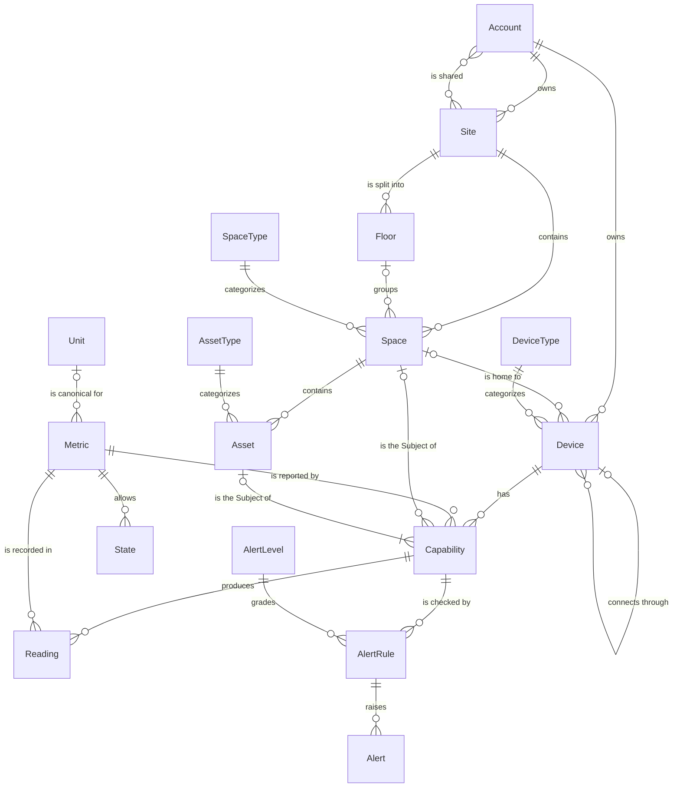
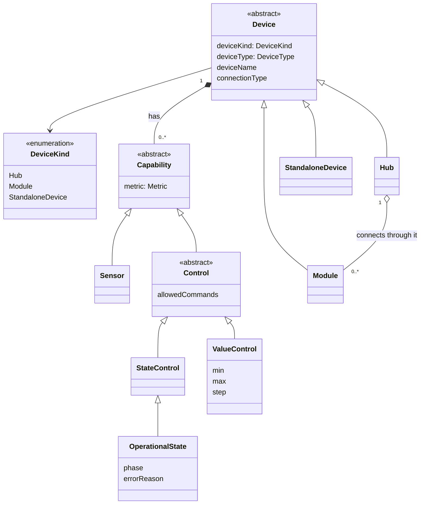
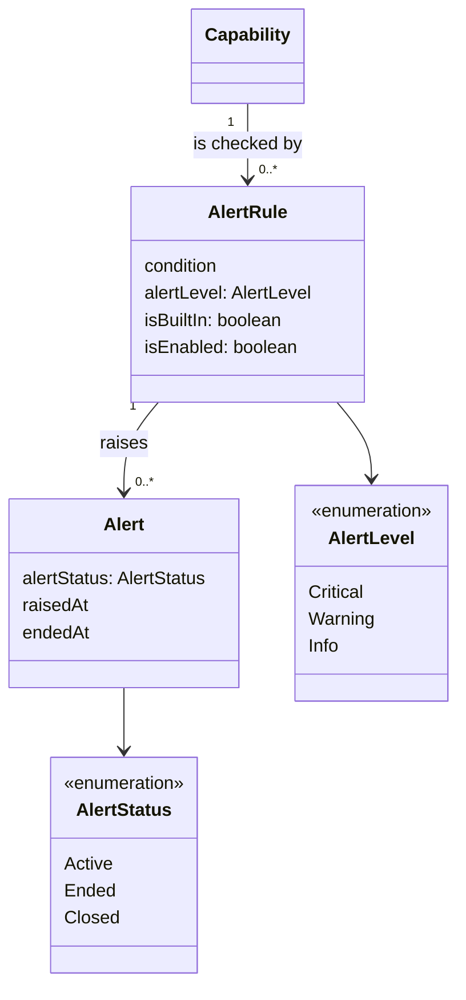
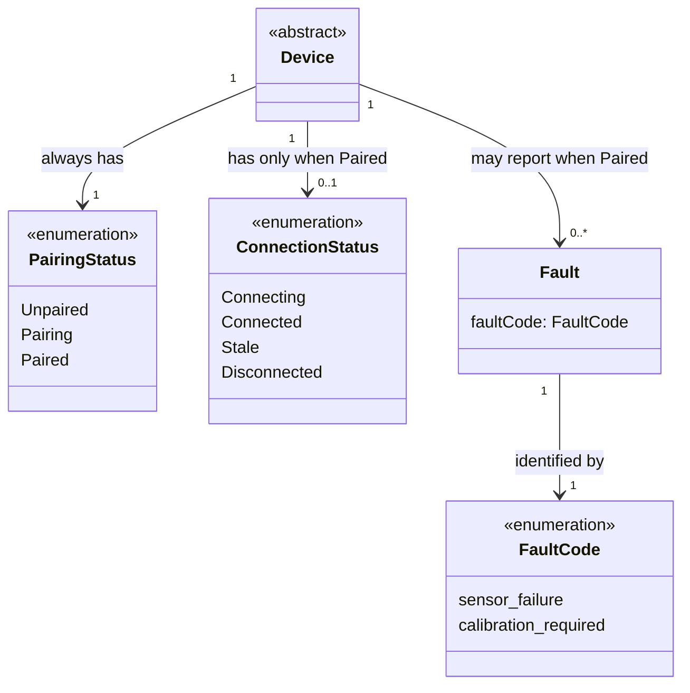

This page shows how the terms in the [Glossary](./glossary.mdx) relate to each other, and **how many** of each thing can sit on each side of a relationship. That "how many" is called **cardinality**.

Entity names in the diagrams are written in PascalCase (`SpaceType`), the names the kit's TypeScript types will use. They mean exactly the glossary term (`SpaceType` = **Space Type**). Rules the diagrams can't express are listed in [Rules the diagrams can't show](#rules-the-diagrams-cant-show).

## The whole model

The full picture, without Device Status. Each section below explains one part.

## Places

The location hierarchy: Site → (Floor) → Space.

- One **Account** owns zero or more **Sites**. Each Site is owned by exactly one Account.
- The owner can **share** a Site with zero or more other Accounts, and an Account can have zero or more Sites shared with it. Shared Accounts can only view the Site.
- One **Site** contains zero or more **Spaces**. Each Space belongs to exactly one Site.
- **Floors** are optional. A Site has zero or more Floors, and a Space sits on zero or one Floor.
- Every **Space** has exactly one **Space Type** (use `Other` when nothing fits). One Space Type is used by many Spaces.

## Devices and Assets

Devices (Hubs, Modules and Standalone Devices) and the Assets their Capabilities are about.

- Every **Device** has exactly one **Device Kind** (how it connects: Hub, Module or Standalone Device) and exactly one **Device Type** (what it is: Climate, Kettle…). One Device Type is used by many Devices.
- A **Hub** has zero or more **Modules** connected through it, by wire or wirelessly. Each Module connects through exactly one Hub. Hubs and Standalone Devices connect through no Hub.
- An **Account** owns zero or more **Hubs** and **Standalone Devices**. Each one belongs to exactly one Account from the moment it is detected: the Account its Device Token belongs to.
- A **Module** has no Space or Account of its own. Its Space and its Account are always its Hub's.
- A **Space** is home to zero or more Hubs and Standalone Devices. Each one is in zero or one Space: it has no Space until it is Paired and placed.
- A **Space** contains zero or more **Assets**. Each Asset is in exactly one Space and has exactly one **Asset Type**.
- An **Asset** is the Subject of one or more **Capabilities**: Sensors that watch it, or Controls that change it. See rule 11 for what happens when the last one is removed.

### Device kinds and Capabilities

Entity diagrams can't show "is a kind of", so this part uses a class diagram. The hollow arrow means "is a kind of".

- A **Capability is not a Device**. It has no Device Status and is never paired on its own: its Device's status applies.
- An **Asset is not a Device**. It isn't connected and has no Device Status.
- The filled diamond (`*--`) means "is made of": when a Device is removed, its Capabilities go with it.
- The hollow diamond (`o--`) means "has", but the parts live on their own: a Module connected through a Hub is still a Device of its own, with its own Device Status.
- Every Module and Standalone Device has at least one Capability. A Hub may have none (rule 27).

## Capabilities and Controls

What a Device reports, and what the user can change.

- A **Device** has zero or more **Capabilities**. Each Capability belongs to exactly one Device.
- A **Capability** is either a **Sensor** (only reports) or a **Control** (reports and can be changed).
- A **Control** is either a **State Control**, whose Metric is a State Metric (Power, Open / Close, Mode), or a **Value Control**, whose Metric is a Measured Metric (Setpoint, Position).
- A **Control** has its own list of **Allowed Commands**. Only Operational State may have none (it is then shown only); a Capability the user can never change is a Sensor (rule 29).
- A **Value Control** has a minimum, a maximum and a step, in its Metric's Unit (rule 30).
- **Operational State** is a kind of State Control. A Device has zero or one. It has a **Phase** only while Running and an **Error Reason** only while Error (rule 31). An Error Reason can point to one Fault Code (rule 33).
- Each command to a Control has exactly one **Command Status**: Pending, Confirmed or Failed. A Control has at most one Pending command at a time.

## Measurements

Metrics, Units, States and the Readings Capabilities produce.

- A **Capability** reports exactly one **Metric**. One Metric can be reported by many Capabilities.
- A **Metric** is either a **Measured Metric** (Temperature, CO₂, Battery, Setpoint, Position…) or a **State Metric** (Power, Contact, Open / Close, Mode, Operational State, Motion, Smoke, CO).
- Each **Measured Metric** has exactly one standard **Unit** in the data. A State Metric has no Unit. A Unit is the standard for zero or more Metrics: `%` is the standard for Battery and Position, and `°F` is only a display Unit.
- Each **State Metric** allows two or more **States**: Power On/Off, Contact Open/Closed, Open / Close Open/Closed/Opening/Closing, Mode Off/Heat, Operational State Stopped/Running/Paused/Error, and Motion, Smoke and CO Detected/Clear. A Measured Metric allows none.
- A **Capability** produces zero or more **Readings**. Each Reading comes from exactly one Capability and records exactly one Metric. Its value is a number for a Measured Metric, or one of the Metric's own States for a State Metric. For a Control, the Reading is the value the Device reports, not the value the user asked for.
- Each **Capability** has exactly one **Subject**: either a Space or an Asset. Every Reading it produces has the same Subject. The diagram shows both links as optional; the rule "exactly one of the two" is in [Rules the diagrams can't show](#rules-the-diagrams-cant-show).
- A **Detection** isn't stored on its own: it is the run of Detected Readings from one Motion, Smoke or CO Sensor, from the first Detected Reading to the next Clear one.

## Alerts

Alert Rules, the Alerts they raise, and their Alert Level and Alert Status.

- A **Capability** (Sensor or Control) is checked by zero or more **Alert Rules**. Each Alert Rule checks exactly one Capability.
- An Alert Rule's **condition** is one of: the Reading is in a given State (for a State Metric), or is above or below a value (for a Measured Metric). A range is two rules on the same Capability: one "below" and one "above".
- Each **Alert Rule** has exactly one **Alert Level**: Critical, Warning or Info.
- The app's developer defines Alert Rules in code, and the UI can show them. Every Smoke and CO Sensor also has one **Built-in Alert Rule** (Critical, condition Detected), on by default; the developer can turn it off.
- An **Alert Rule** raises zero or more **Alerts** over time, but at most one Active Alert at a time. Each Alert comes from exactly one Alert Rule, so its Capability, Space and Alert Level follow from that rule.
- Each **Alert** has exactly one **Alert Status**: Active, Ended or Closed.

## Device Status

Device Status is three separate fields. The cardinality shows the key rule: a Device **always** has a Pairing Status, but has a Connection Status **only when Paired**. Stale applies only to Devices with Capabilities (rule 15).

- **Pairing Status**: exactly one, always.
- **Connection Status**: zero or one. It exists only when Pairing Status is `Paired`. Only a Device with Capabilities can be `Stale`: a Hub without Capabilities never sends Readings of its own.
- **Fault**: zero or more ("None, or one or more Faults"), and only when Pairing Status is `Paired`. A Device can report several Faults at once, for example two broken Sensors. Faults are independent of Connection Status, so a Device can be `Connected` and have a Fault.
- Each **Fault** has exactly one **Fault Code**.

## Cardinality summary

| From                     | Relationship             | To                       | From side | To side                                          |
| ------------------------ | ------------------------ | ------------------------ | --------- | ------------------------------------------------ |
| Account                  | owns                     | Site                     | 1         | 0..\*                                            |
| Site                     | is shared with           | Account                  | 0..\*     | 0..\*                                            |
| Account                  | owns                     | Hub or Standalone Device | 1         | 0..\*                                            |
| Site                     | contains                 | Space                    | 1         | 0..\*                                            |
| Site                     | is split into            | Floor                    | 1         | 0..\*                                            |
| Floor                    | groups                   | Space                    | 0..1      | 0..\*                                            |
| Space Type               | categorizes              | Space                    | 1         | 0..\*                                            |
| Space                    | is home to               | Hub or Standalone Device | 0..1      | 0..\*                                            |
| Hub                      | has connected through it | Module                   | 1         | 0..\*                                            |
| Device Type              | categorizes              | Device                   | 1         | 0..\*                                            |
| Device                   | has                      | Capability               | 1         | 0..\* (1..\* for Modules and Standalone Devices) |
| Space                    | contains                 | Asset                    | 1         | 0..\*                                            |
| Asset Type               | categorizes              | Asset                    | 1         | 0..\*                                            |
| Asset                    | is the Subject of        | Capability               | 0..1      | 1..\*                                            |
| Metric                   | is reported by           | Capability               | 1         | 0..\*                                            |
| Unit                     | is canonical for         | Metric                   | 0..1      | 0..\*                                            |
| Metric                   | allows                   | State                    | 1         | 0 (Measured) or 2..\* (State)                    |
| Capability               | produces                 | Reading                  | 1         | 0..\*                                            |
| Metric                   | is recorded in           | Reading                  | 1         | 0..\*                                            |
| Subject (Space or Asset) | is the Subject of        | Capability               | 1         | 0..\*                                            |
| Device                   | has                      | Operational State        | 1         | 0..1                                             |
| Capability               | is checked by            | Alert Rule               | 1         | 0..\*                                            |
| Alert Level              | grades                   | Alert Rule               | 1         | 0..\*                                            |
| Alert Rule               | raises                   | Alert                    | 1         | 0..\* (at most 1 Active)                         |
| Alert                    | has                      | Alert Status             | 1         | 1                                                |
| Device                   | has                      | Pairing Status           | 1         | 1                                                |
| Device                   | has                      | Connection Status        | 1         | 0..1 (only when Paired)                          |
| Device                   | may report               | Fault                    | 1         | 0..\* (only when Paired)                         |
| Fault                    | identified by            | Fault Code               | 1         | 1                                                |

## Rules the diagrams can't show

These rules are always true, even where a diagram can't show them.

1. **A Module belongs to exactly one Hub**: the Hub it connects through, whether it is listed in the Hub's settings (wired) or found by a search (wireless).
2. **A Module's Space is its Hub's Space.** A Module never stores its own Space.
3. **A Capability's Metric is fixed by its Device.** The user can't change it.
4. **A Capability can only be about an Asset in its own Space.** The Asset's Space must equal its Device's Space (for a Module, its Hub's Space).
5. **A Capability, and every Reading it produces, has exactly one Subject.** If the Capability is about an Asset, the Subject is that Asset; otherwise it is the Device's Space.
6. **A Reading never changes once recorded.** Its Capability, Metric, value, Unit and time are fixed.
7. **A Reading of a Measured Metric is stored in its Metric's canonical Unit.** Other Units are only for display. A Reading of a State Metric has no Unit.
8. **Connection Status exists only when Pairing Status is `Paired`.**
9. **A Floor and its Spaces belong to the same Site.**
10. **A Hub or Standalone Device gets a Space only after it is Paired.** An Unpaired or Pairing Device has no Space.
11. **An Asset always has at least one Capability about it.** When the last one is removed (for example, its Device is removed), the Asset is removed too, and so are all Readings about it.
12. **A Module can move to another Hub, but it starts again.** It pairs again on the new Hub, and its past Readings are deleted. See [Device lifecycle](./device-lifecycle.mdx#moving-a-module-to-another-hub).
13. **A Site has exactly one owner.** The Accounts it is shared with never include its owner.
14. **Sharing is view-only.** Accounts a Site is shared with can see it and its Readings, but can't change anything, send commands to its Devices, or share it further. Only the owner makes changes.
15. **Only Devices with Capabilities can be Stale.** Stale means no Reading arrived within the Expected Interval, and only Capabilities produce Readings. A Hub without Capabilities is Connecting, Connected or Disconnected.
16. **A Hub or Standalone Device belongs to exactly one Account,** the one its Device Token belongs to. A Hub's Modules belong to the same Account.
17. **A Hub or Standalone Device can only be placed in a Space its Account owns.** The Space's Site must be owned by the Device's Account.
18. **A Reading's value matches its Metric.** A number for a Measured Metric; one of the Metric's own States for a State Metric (a Power Reading is never Open).
19. **Contact Readings are about an Asset; Motion, Smoke and CO Readings are about the Space.** A Contact Sensor watches a Door or Window.
20. **Every Device with Capabilities sends its current Readings at least once per Expected Interval**, even when nothing has changed. A closed door still reports Closed. So no Reading within the Expected Interval always means a problem (Stale).
21. **An Alert Rule's condition matches its Capability's Metric.** "In a State" only for a State Metric, and only with one of that Metric's States; "above" or "below" only for a Measured Metric.
22. **An Alert Rule has at most one Active Alert.** A new Alert is raised only when the condition becomes true again after it was no longer true.
23. **An Alert ends by itself or is closed.** It becomes Ended when its condition is no longer true, or Closed when the user closes it while it is Active. Neither ever becomes Active again.
24. **A Closed Alert doesn't hide the problem.** While the condition is still true, the Reading itself still shows it (Smoke Detected on the Device's card).
25. **Only the Site's owner can close an Alert.** Accounts the Site is shared with only see Alerts (rule 14).
26. **Every Smoke and CO Sensor has a Built-in Alert Rule**: Critical, condition Detected. It is on by default; the app's developer can turn it off.
27. **Every Module and Standalone Device has at least one Capability.** A Hub may have none.
28. **Only Modules connect through a Hub.** A Hub never connects through another Hub, and a Standalone Device never connects through one.
29. **A Control accepts only its Allowed Commands.** Any other command is refused, and the UI doesn't offer it. Only Operational State may have no Allowed Commands (it is then shown only); a Capability the user can never change is a Sensor.
30. **A Value Control accepts only values inside its range and on its step**, in its Metric's Unit. Setpoint 0–30 °C in steps of 0.5 refuses 31 °C and 22.3 °C.
31. **A Device has at most one Operational State.** It has a Phase only while Running and an Error Reason only while Error. The user can't choose Error or a Phase: the Device reports them.
32. **A Device that runs a task has a Power Control only if the real device has a separate power button.** When its Power is Off, its Operational State is Stopped and Start isn't allowed.
33. **Operational State Error and Fault are separate.** A Fault can cause an Error; then the Error Reason points to that Fault Code, and the UI shows one message. A Fault doesn't have to cause an Error (a thermostat that needs calibration can keep Running), and an Error doesn't need a Fault (a kettle with no water).
34. **A command never changes a Reading by itself.** A Control's value changes only when the Device reports a new Reading. Until then, the command is Pending.
35. **Only the Device's Account can send commands to its Controls,** and only one command per Control can be Pending at a time.

## Related

- [Glossary](./glossary.mdx): what each term in the diagrams means.
- [Device lifecycle](./device-lifecycle.mdx): how a Device moves between the statuses shown here, and how a command moves from Pending to Confirmed or Failed.
- [Events and commands](./events-and-commands.mdx): what changes the data, and what a user can ask for.
