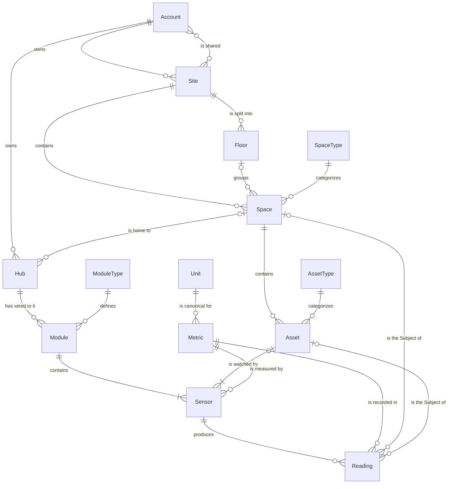
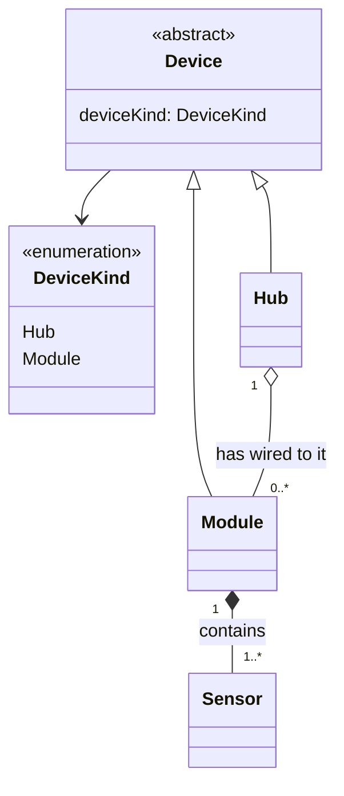
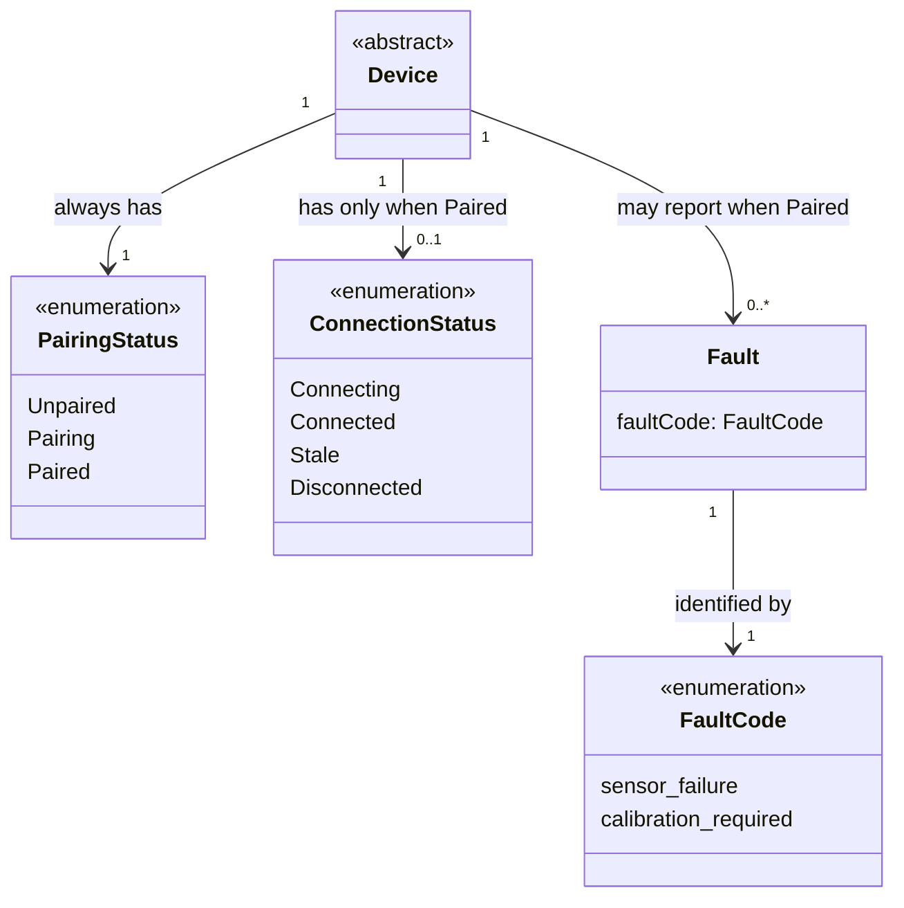

This page shows how the terms in the [Glossary](./glossary.mdx) relate to each other, and **how many** of each thing can sit on each side of a relationship. That "how many" is called **cardinality**.

Entity names in the diagrams are written in PascalCase (`SpaceType`), the names the kit's TypeScript types will use. They mean exactly the glossary term (`SpaceType` = **Space Type**). Rules the diagrams can't express are listed in [Rules the diagrams can't show](#rules-the-diagrams-cant-show).

## The whole model

The full picture, without Device Status. Each section below explains one part.

## Places

The location hierarchy: Site → (Floor) → Space.

- One **Account** owns zero or more **Sites**. Each Site is owned by exactly one Account.
- The owner can **share** a Site with zero or more other Accounts, and an Account can have zero or more Sites shared with it. Shared Accounts can only view the Site.
- One **Site** contains zero or more **Spaces**. Each Space belongs to exactly one Site.
- **Floors** are optional. A Site has zero or more Floors, and a Space sits on zero or one Floor.
- Every **Space** has exactly one **Space Type** (use `Other` when nothing fits). One Space Type is used by many Spaces.

## Devices and Assets

Devices (Hub and Module), the Sensors on Modules, and the Assets that Sensors watch.

- A **Space** is home to zero or more **Hubs**. A Hub is in zero or one Space: it has no Space until it is Paired and placed.
- An **Account** owns zero or more **Hubs**. Each Hub belongs to exactly one Account, from the moment it is detected: the Account its Hub Token belongs to.
- A **Hub** has zero or more **Modules** wired to it. Each Module belongs to exactly one Hub: the one whose settings list it.
- A **Module** has no Space or Account of its own. Its Space and its Account are always its Hub's.
- Every **Module** has exactly one **Module Type** (a category such as Climate). Which **Sensors** it contains (at least one) depends on its board.
- A **Sensor** belongs to exactly one Module.
- A **Space** contains zero or more **Assets**. Each Asset is in exactly one Space and has exactly one **Asset Type**.
- An **Asset** is watched by one or more **Sensors**. A Sensor watches zero or one Asset: zero means it measures the Space itself (room air). See rule 11 for what happens when its last Sensor is removed.

### Device is the parent of Hub and Module

Entity diagrams can't show "is a kind of", so this part uses a class diagram. The hollow arrow means "is a kind of".

- A **Sensor is not a Device**. It has no Device Status and is never paired on its own.
- An **Asset is not a Device**. It isn't connected and has no Device Status.
- The filled diamond (`*--`) means "is made of": when a Module is removed, its Sensors go with it.
- The hollow diamond (`o--`) means "has", but the parts live on their own: a Module wired to a Hub is still a Device of its own, with its own Device Status.

## Measurements

Metrics, Units and the Readings Sensors produce.

- A **Sensor** measures exactly one **Metric**. One Metric can be measured by many Sensors.
- Each **Metric** has exactly one standard **Unit** in the data. A Unit is the standard for zero or one Metric: `°F`, for example, is only a display Unit.
- A **Sensor** produces zero or more **Readings**. Each Reading comes from exactly one Sensor and records exactly one Metric.
- Each **Reading** has exactly one **Subject**: either a Space or an Asset. The diagram shows both links as optional; the rule "exactly one of the two" is in [Rules the diagrams can't show](#rules-the-diagrams-cant-show).

## Device Status

Device Status is three separate fields. The cardinality shows the key rule: a Device **always** has a Pairing Status, but has a Connection Status **only when Paired**. Stale applies to Modules only (rule 15).

- **Pairing Status**: exactly one, always.
- **Connection Status**: zero or one. It exists only when Pairing Status is `Paired`. Only a Module can be `Stale`: a Hub has no Sensors, so it never sends Readings of its own.
- **Fault**: zero or more ("None, or one or more Faults"), and only when Pairing Status is `Paired`. A Device can report several Faults at once, for example two broken Sensors. Faults are independent of Connection Status, so a Device can be `Connected` and have a Fault.
- Each **Fault** has exactly one **Fault Code**.

## Cardinality summary

| From                     | Relationship      | To                | From side | To side                  |
| ------------------------ | ----------------- | ----------------- | --------- | ------------------------ |
| Account                  | owns              | Site              | 1         | 0..\*                    |
| Site                     | is shared with    | Account           | 0..\*     | 0..\*                    |
| Account                  | owns              | Hub               | 1         | 0..\*                    |
| Site                     | contains          | Space             | 1         | 0..\*                    |
| Site                     | is split into     | Floor             | 1         | 0..\*                    |
| Floor                    | groups            | Space             | 0..1      | 0..\*                    |
| Space Type               | categorizes       | Space             | 1         | 0..\*                    |
| Space                    | is home to        | Hub               | 0..1      | 0..\*                    |
| Hub                      | has wired to it   | Module            | 1         | 0..\*                    |
| Module Type              | defines           | Module            | 1         | 0..\*                    |
| Module                   | contains          | Sensor            | 1         | 1..\*                    |
| Space                    | contains          | Asset             | 1         | 0..\*                    |
| Asset Type               | categorizes       | Asset             | 1         | 0..\*                    |
| Asset                    | is watched by     | Sensor            | 0..1      | 1..\*                    |
| Metric                   | is measured by    | Sensor            | 1         | 0..\*                    |
| Unit                     | is canonical for  | Metric            | 1         | 0..\*                    |
| Sensor                   | produces          | Reading           | 1         | 0..\*                    |
| Metric                   | is recorded in    | Reading           | 1         | 0..\*                    |
| Subject (Space or Asset) | is the Subject of | Reading           | 1         | 0..\*                    |
| Device                   | has               | Pairing Status    | 1         | 1                        |
| Device                   | has               | Connection Status | 1         | 0..1 (only when Paired)  |
| Device                   | may report        | Fault             | 1         | 0..\* (only when Paired) |
| Fault                    | identified by     | Fault Code        | 1         | 1                        |

## Rules the diagrams can't show

These rules are always true, even where a diagram can't show them.

1. **A Module belongs to exactly one Hub**: the Hub whose settings list it.
2. **A Module's Space is its Hub's Space.** A Module never stores its own Space.
3. **A Sensor's Metric is fixed by its board.** The user can't change it.
4. **A Sensor can only watch an Asset in its own Space.** The Asset's Space must equal the Space of the Sensor's Hub.
5. **A Reading has exactly one Subject.** If its Sensor watches an Asset, the Subject is that Asset; otherwise it is the Sensor's Space.
6. **A Reading never changes once recorded.** Its Sensor, Metric, value, Unit and time are fixed.
7. **A Reading is stored in its Metric's canonical Unit.** Other Units are only for display.
8. **Connection Status exists only when Pairing Status is `Paired`.**
9. **A Floor and its Spaces belong to the same Site.**
10. **A Hub gets a Space only after it is Paired.** An Unpaired or Pairing Hub has no Space.
11. **An Asset always has at least one Sensor.** When the last Sensor watching an Asset is removed (for example, its Module is removed), the Asset is removed too, and so are all Readings about it.
12. **A Module can move to another Hub, but it starts again.** It pairs again on the new Hub, and its past Readings are deleted. See [Device lifecycle](./device-lifecycle.mdx#moving-a-module-to-another-hub).
13. **A Site has exactly one owner.** The Accounts it is shared with never include its owner.
14. **Sharing is view-only.** Accounts a Site is shared with can see it and its Readings, but can't change anything or share it further. Only the owner makes changes.
15. **Only Modules can be Stale.** Stale means no Reading arrived within the Expected Interval, and only Modules send Readings. A Hub is Connecting, Connected or Disconnected.
16. **A Hub belongs to exactly one Account,** the one its Hub Token belongs to. Its Modules belong to the same Account.
17. **A Hub can only be placed in a Space its Account owns.** The Space's Site must be owned by the Hub's Account.

## Related

- [Glossary](./glossary.mdx): what each term in the diagrams means.
- [Device lifecycle](./device-lifecycle.mdx): how a Device moves between the statuses shown here.
- [Events and commands](./events-and-commands.mdx): what changes the data, and what a user can ask for.
