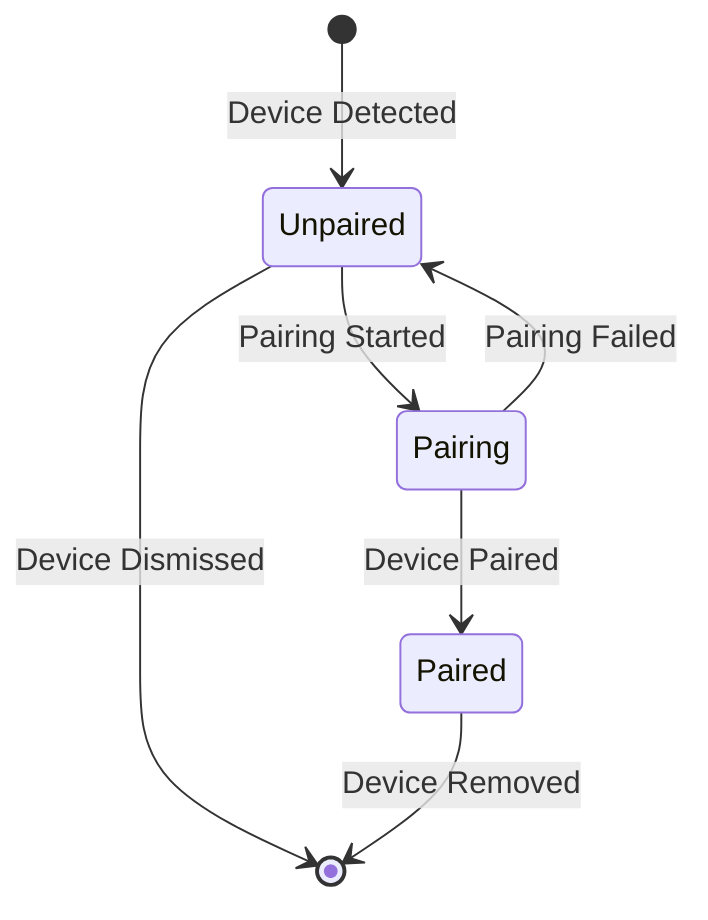
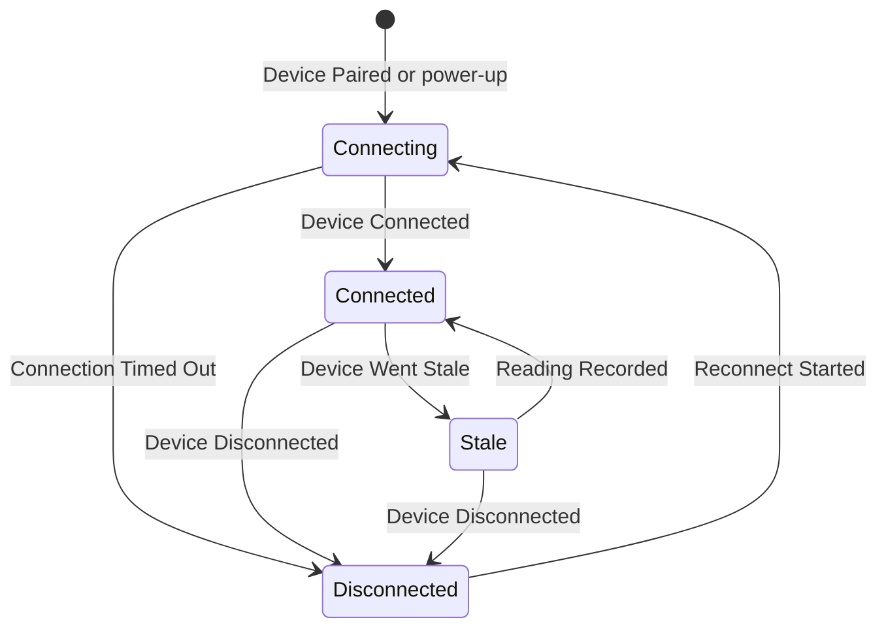
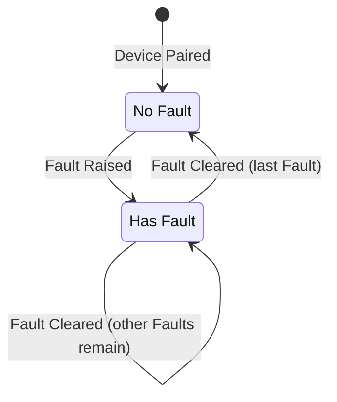
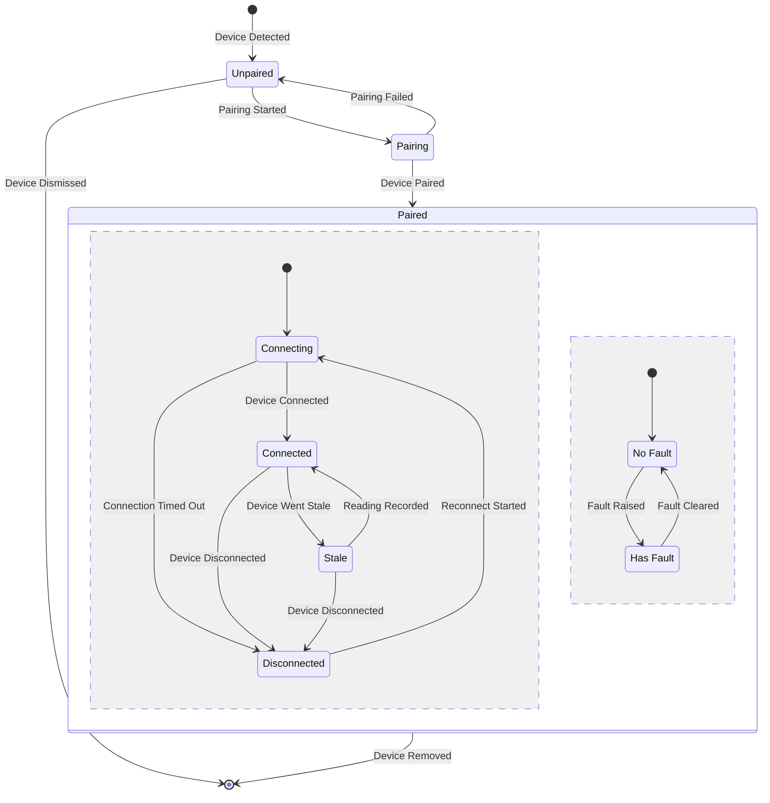
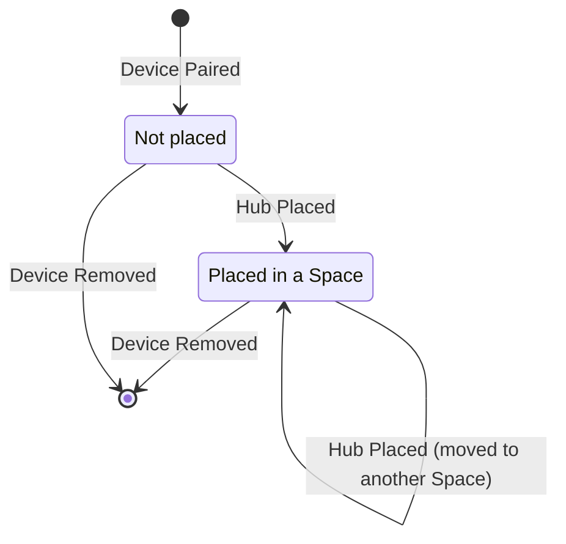
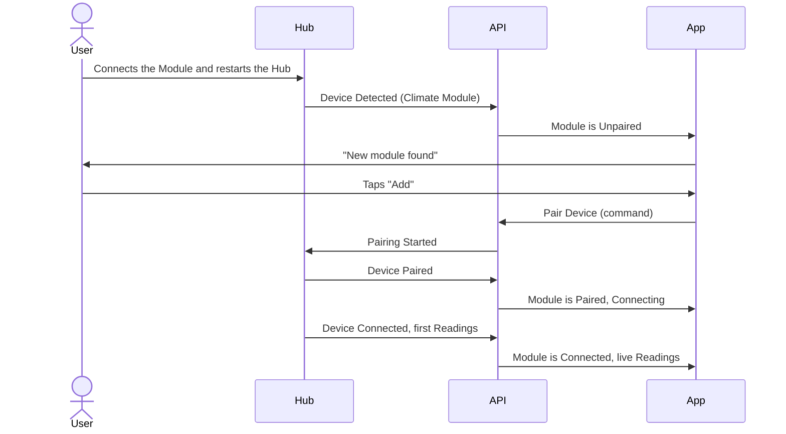
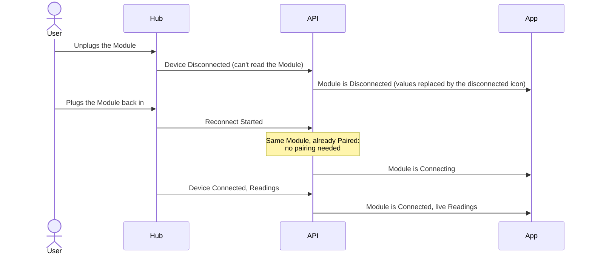

A **Device** (a Hub or a Module) moves through its life in steps: it is detected, paired, connects and disconnects day to day, and is finally removed. This page shows each step, the rules behind them, and what the UI shows. It builds on the [Glossary](./glossary.mdx) and the [Data model](./data-model.mdx). The events that move a Device between statuses, like Device Paired, are listed on [Events and commands](./events-and-commands.mdx).

## Three independent fields

The glossary splits Device Status into three fields. Each one has its own small lifecycle:

| Field                 | Question                                  | Exists when                                                           |
| --------------------- | ----------------------------------------- | --------------------------------------------------------------------- |
| **Pairing Status**    | Is this Device registered to the Account? | Always, from the moment the Device is detected                        |
| **Connection Status** | Can we reach it right now?                | Only while the Device is **Paired**                                   |
| **Fault**             | Is the hardware healthy?                  | Only while the Device is **Paired**. Independent of Connection Status |

Keeping them apart is what allows real combinations like "Connected **and** has a Fault", and makes impossible ones like "Unpaired **and** Stale" impossible to express.

## Pairing Status

Pairing answers "does this Device belong to the Account?". It changes rarely: usually once when the Device is added, and once when it's removed.

| Status       | What it means                                                              | How it gets there                                                                                                    |
| ------------ | -------------------------------------------------------------------------- | -------------------------------------------------------------------------------------------------------------------- |
| **Unpaired** | The Device has been seen, but the user hasn't added it yet.                | **Device Detected**: the Hub finds a new Module in its settings, or a new Hub comes online. Also **Pairing Failed**. |
| **Pairing**  | First-time setup is running: joining the Account.                          | **Pairing Started**: the user taps "Add".                                                                            |
| **Paired**   | The Device belongs to the Account. From now on it has a Connection Status. | **Device Paired**: setup finished.                                                                                   |

Leaving the lifecycle:

- **Device Dismissed**: the user ignores a detected Device ("Not now"). It disappears from the list until it's detected again.
- **Device Removed**: the user removes a Paired Device from the Account. Its past Readings stay; the Device can be detected and paired again later.

## Connection Status

Connection answers "can we reach it right now?". It changes often: after every power cut, restart or Wi-Fi drop. It only exists while the Device is Paired. Only Modules can be Stale: a Hub has no Sensors, so it goes straight between Connected and Disconnected.

| Status           | What it means                                                                                                                                     | How it gets there                                                                               |
| ---------------- | ------------------------------------------------------------------------------------------------------------------------------------------------- | ----------------------------------------------------------------------------------------------- |
| **Connecting**   | Establishing or re-establishing the connection.                                                                                                   | Right after **Device Paired**, after a power-up, or **Reconnect Started** after a dropped link. |
| **Connected**    | Reachable, and Readings arrive on time.                                                                                                           | **Device Connected**, or a **Reading Recorded** while Stale.                                    |
| **Stale**        | Modules only. Still reachable, but no Reading arrived within its Expected Interval (set by the user).                                             | **Device Went Stale**: the API raises it when the Expected Interval passes with no Reading.     |
| **Disconnected** | Can't be reached, for example a Hub lost Wi-Fi or a Module was unplugged. Last known values are hidden: a disconnected icon shows in their place. | **Device Disconnected**, or **Connection Timed Out** while Connecting.                          |

There is no end state: a Paired Device keeps cycling between these statuses until it is removed.

## Fault

Fault answers "is the hardware healthy?". The Device reports it about itself, so it is independent of connection. Only Paired Devices have Faults: a Device that isn't Paired yet has none.

- **Fault Raised** carries a **Fault Code**, for example `sensor_failure` or `calibration_required`.
- **Fault Cleared** happens when the Device stops reporting the problem, for example after recalibration.
- A Device can have **several Faults at once**, one per Fault Code. A new Fault is added to the ones already there; it doesn't replace them.
- **Has Fault** means one or more Faults. The Device goes back to **No Fault** only when its last Fault is cleared.

## The whole lifecycle

All three fields together. Inside **Paired**, the dashed line splits two things that run **at the same time**: Connection Status on top and Fault below. Both exist only while the Device is Paired.

## Hub and Module differences

Hubs and Modules share the same three fields, but they reach them in different ways.

|                           | Hub                                                                | Module                                                                   |
| ------------------------- | ------------------------------------------------------------------ | ------------------------------------------------------------------------ |
| **Who detects it**        | The API, when a new Hub first comes online and sends its Hub Token | Its Hub, when the Hub starts and finds the Module listed in its settings |
| **Can be paired when**    | Any time                                                           | Only when its Hub is Paired                                              |
| **Gets a location**       | **Hub Placed** in a Space, after it is Paired                      | Never directly. It's always in its Hub's Space                           |
| **Physical events**       | Power-up, power cut, Wi-Fi drop                                    | Unplugged and plugged back in                                            |
| **Connection depends on** | Its own link to the API                                            | Its Hub. If the Hub is Disconnected, the Module is too                   |

### Hub placement

A Hub has a second, smaller lifecycle: where it is.

### Unplugging a Module

Unplugging doesn't remove a Module. While it is unplugged, the Hub can't read it, so it is **Disconnected** but stays **Paired**. When it's plugged back into the same Hub, it reconnects (Connecting, then Connected) with the same identity and keeps its Readings. Only removing it from the Hub's settings, or **Device Removed**, takes it out of the Account.

### Moving a Module to another Hub

A Module can be moved to another Hub, but it doesn't keep anything from the old one. Moving counts as removing the Module and adding it again:

1. On the old Hub, the Module is removed (**Device Removed**), and its past Readings are **deleted**.
2. On the new Hub, it is detected like a new Module (**Device Detected**) and is **Unpaired**.
3. The user adds it again (**Pairing Started**, **Device Paired**). Its Readings history starts empty.

## Flow: adding a new Module

What happens, step by step, when someone adds a new Climate Module to a Paired Hub. "App" is the app you build with the kit.

## Flow: unplugging and plugging back in

A Paired Module is unplugged and plugged back into the same Hub. It keeps its identity, so it doesn't need to pair again, and your app keeps using the same Module.

## Rules

These add to the [rules in the Data model](./data-model.mdx#rules-the-diagrams-cant-show). [Events and commands](./events-and-commands.mdx) shows which events and commands follow which rule.

1. **Connection Status exists only while Paired.** (Data model rule 8.)
2. **A Paired Device always starts at Connecting**, never straight at Connected.
3. **A Module can be paired only when its Hub is Paired.**
4. **If a Hub is Disconnected, all its Modules are Disconnected.** When the Hub reconnects, its Modules go to Connecting.
5. **An unplugged Module is Disconnected but stays Paired.** When plugged back into the same Hub, it reconnects with the same identity, keeps its Readings and doesn't pair again.
6. **Stale is decided from Readings, not from the link.** Only Modules send Readings, so only Modules can be Stale. A Module is Stale only if it is reachable but no Reading arrived within its Expected Interval. Every Module sends its current Readings at least once per Expected Interval, even when nothing has changed (a closed door still reports Closed), so Stale always means a problem. What counts is when a Reading **arrives**, not the time inside it: a late Reading, sent after a Wi-Fi drop, still moves a Module from Stale back to Connected.
7. **Fault never changes Pairing or Connection Status**, and they never clear a Fault.
8. **Removing a Device keeps its Readings**, with two exceptions: a Module moved to another Hub loses its past Readings (rule 9), and Readings about an Asset are deleted when the Asset is removed ([Data model rule 11](./data-model.mdx#rules-the-diagrams-cant-show)).
9. **A Module moved to another Hub pairs again and starts with no Readings.** Its past Readings are deleted. Unplugging and plugging back into the same Hub keeps everything (rule 5).
10. **Only Paired Devices have Faults.** A Device's Faults start when it is Paired and end when it is removed.
11. **A Hub is detected the first time it comes online.** It identifies itself with its Hub Token, and only the Account that token belongs to sees it.
12. **A Module is detected from its Hub's settings.** The Hub raises **Device Detected** when it starts and finds a listed Module that isn't Paired yet. It never searches for Modules by itself.

## What the UI shows

How each status maps to what the kit's [UI components](/docs/ui-components) show.

| Device status                 | What the components show                                                                                                                                                                                                        |
| ----------------------------- | ------------------------------------------------------------------------------------------------------------------------------------------------------------------------------------------------------------------------------- |
| Unpaired                      | [`DevicePairingStatus`](/docs/ui-components/status/device-pairing-status): "Unpaired". Your app decides how to offer **Add** and **Not now**.                                                                                   |
| Pairing                       | `DevicePairingStatus`: "Pairing".                                                                                                                                                                                               |
| Paired + Connecting           | [`DeviceConnectionStatus`](/docs/ui-components/status/device-connection-status): "Connecting". [`ModuleCard`](/docs/ui-components/readings/module-card) keeps the last values, or shows a loading icon until the first Reading. |
| Paired + Connected            | "Connected", with the live values.                                                                                                                                                                                              |
| Paired + Stale (Modules only) | "Stale", with the last values unchanged.                                                                                                                                                                                        |
| Paired + Disconnected         | "Disconnected". The values are hidden and a disconnected icon shows in their place.                                                                                                                                             |
| Paired + Has Fault            | [`DeviceFaultStatus`](/docs/ui-components/status/device-fault-status): a message for each Fault Code, **on top of** the connection status.                                                                                      |

## Related

- [Events and commands](./events-and-commands.mdx): every event and command named on this page.
- [Glossary](./glossary.mdx): what each status means.
- [Data model](./data-model.mdx): how Devices relate to Spaces, Sensors and Readings.
