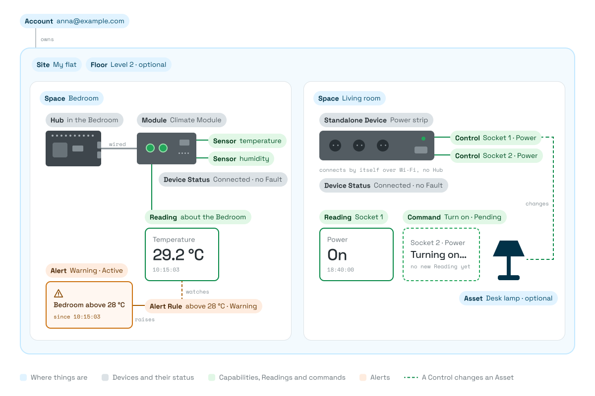

The domain model is the kit's **ready-made description of a smart home**: what exists, how those things relate, and what state each one is in. The Figma and React components are built on it and use its names, so you can start building without designing a model yourself.

## How it works

- **An Account owns a Site**, like "My flat". A Site is split into **Spaces**, like "Bedroom".
- **Devices are placed in Spaces.** A **Hub** has **Modules** connected to it, by wire or wirelessly. A **Standalone Device**, like a Wi-Fi kettle or a power strip, connects by itself.
- **Each Device has Capabilities.** A **Sensor** only reports, like Temperature. A **Control** can also be changed, like a socket's Power or the heating's Setpoint.
- **A Capability produces Readings**: a value and the time. The value is a number with its Unit, like 22.4 °C at 10:15:03, or a State, like Front door Open.
- **A command to a Control is Pending** until the Device reports the new value.
- **Alert Rules watch Capabilities** and raise an **Alert** when their condition becomes true, like Smoke Detected or temperature above 28 °C.
- **Every Device has a Device Status**: Pairing Status, Connection Status and Fault.

The picture shows one setup: a Hub with a wired Module. The same model covers wireless Modules and Standalone Devices.

## What's in this section

| Page                                             | Read it when                                                               |
| ------------------------------------------------ | -------------------------------------------------------------------------- |
| [Glossary](./glossary.mdx)                       | You meet a term you don't know. Start here.                                |
| [Data model](./data-model.mdx)                   | You design your own data or types.                                         |
| [Device lifecycle](./device-lifecycle.mdx)       | You show Device statuses, or handle a Device going offline.                |
| [Events and commands](./events-and-commands.mdx) | You react to status changes, or send commands like Pair Device or Turn on. |
