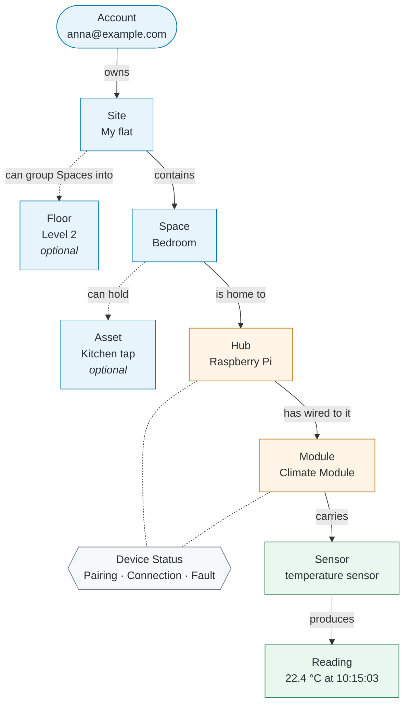
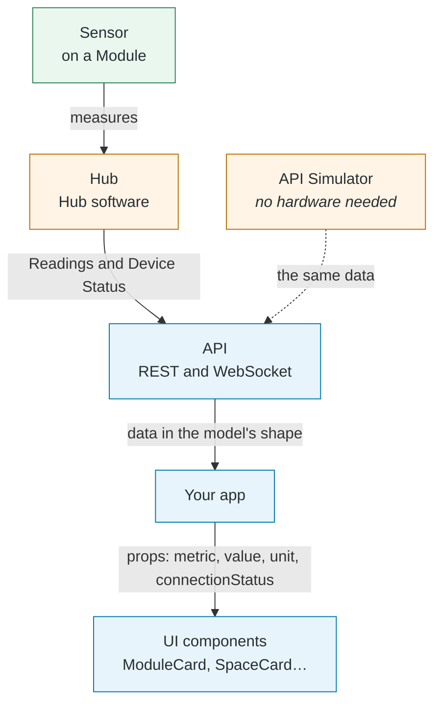

# Domain Model

The domain model is the kit's **ready-made description of a smart home**: what things exist (a Site, a Space, a Hub, a Sensor, a Reading…), how they relate to each other, and how a Device moves through its life. Every part of the kit is built on it, so you can start building an app without designing that model yourself.

## Why it exists

Every smart home app has to answer the same questions first. What is a "room"? Is a sensor the same thing as a device? What do you show when a device is unplugged? If every app answers them differently, nothing fits together.

The kit answers them once, and uses the answers everywhere:

- **One name for each thing.** A word means the same in the docs, the API, the TypeScript types and the UI components. A "Space" is always a Space, never a "room" in one place and an "area" in another.
- **Rules you don't have to invent.** For example: a Sensor is not a Device and has no status of its own; a Disconnected Device's last values are hidden; a Reading never changes once recorded.
- **The same model in every part of the kit.** The UI components take props named after it (`connectionStatus`, `metric`, `unit`), and the planned API, API Simulator and Hub software send data shaped by it. Learn it once, and every part makes sense.

## How it works together

A smart home in the kit, from the person who owns it down to a single measurement. Blue is **where things are**, orange the **Devices** (the connected hardware), green **what is measured**. Dotted lines are optional.

Read it from the top:

1. **An Account owns Sites.** A Site is a property the person monitors, like "My flat". They can share it with other Accounts, who can only view it.
2. **A Site is split into Spaces**, like "Bedroom" or "Balcony". A large Site can also group its Spaces into Floors.
3. **A Hub is placed in a Space.** It's a Raspberry Pi running the kit's Hub software.
4. **Modules are wired to the Hub.** Each Module is a sensor board, like a Climate Module, and belongs to its Hub's Space.
5. **Each Module carries one or more Sensors**, and each Sensor measures exactly one **Metric**, like Temperature.
6. **A Sensor produces Readings**: one value, with its Unit and the time, like 22.4 °C at 10:15:03. A Reading is about its Space, or about an **Asset** in it, like a tap a water Sensor watches.
7. **Hubs and Modules are Devices**, so they have a **Device Status**: whether they're Paired, whether they can be reached right now, and whether they report a Fault. Sensors, Spaces and Assets have no status of their own.

## From a Sensor to the screen

How a Reading travels through the kit, and where the domain model shapes it:

- **The Hub** reads its Sensors and reports Readings and its Devices' statuses.
- **The API Simulator** sends the same data with no hardware at all, so you can build before you own a Hub. An app can't tell simulated Devices from real ones.
- **Your app** gets the data and passes it to the UI components as props. The components never fetch data themselves.
- **The UI components** show it, with the right state for each Device Status: for example, a Stale label, or a hidden value when a Device is Disconnected.

The Hub software, the API and the API Simulator are planned parts of the kit. The UI components are ready: see [UI Components](/docs/ui-components).

## The pages in this section

| Page                                               | Answers                                                    | Read it when                                               |
| -------------------------------------------------- | ---------------------------------------------------------- | ---------------------------------------------------------- |
| [Glossary](./glossary.mdx)                         | "What does this word mean?"                                | You meet a term you don't know. Start here.                |
| [Data model](./data-model.mdx)                     | "How do the things relate, and how many of each?"          | You design your own data or API types.                     |
| [Device lifecycle](./device-lifecycle.mdx)         | "How does a Device move from detected to removed?"         | You show Device statuses, or handle a Device going offline. |
| [Events and commands](./events-and-commands.mdx)   | "What happens when a status changes, and what can a user ask for?" | You react to changes, or send commands like Pair Device. |

## Three things worth remembering

- **A Sensor is not a Device.** It's a measuring element on a Module. Connection Status and Faults belong to its Module.
- **Device Status is three separate fields.** Pairing Status (does it belong to the Account?), Connection Status (can it be reached right now?) and Fault (is the hardware healthy?). A Device can be Connected and have a Fault at the same time.
- **A Disconnected Device's values are hidden.** Its last value could look up to date when it isn't, so the UI shows a disconnected icon instead.
