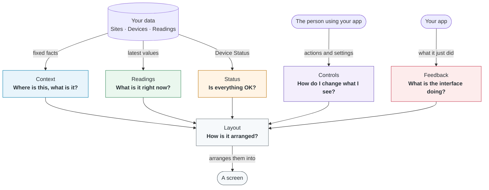

# UI Components

The kit's React components for smart home screens. They show Sites, Spaces, Devices and Readings using the words of the [Domain Model](/docs/domain-model/glossary), so you can build a screen without designing those pieces yourself.

## How the components are grouped

Every component belongs to one group, and each group answers **one question** about the home. Knowing the question tells you which group to look in.



The groups differ in **where their content comes from** and **how often it changes**:

| Group                 | Answers                        | Shows                                                             | Changes when                                                                   | Examples                                        |
| --------------------- | ------------------------------ | ----------------------------------------------------------------- | ------------------------------------------------------------------------------ | ----------------------------------------------- |
| [Context](#context)   | "Where is this, what is it?"   | Fixed facts: where a Device is, what a Sensor measures.           | Almost never: only when the user renames or moves something.                   | `LocationPath`, `SensorLabel`                   |
| [Readings](#readings) | "What is it right now?"        | Current values, from one number up to a card for a whole Space.   | With every new Reading, every few seconds.                                     | `ReadingValue`, `ModuleCard`, `SpaceCard`       |
| [Status](#status)     | "Is everything OK?"            | The state of a Device: Pairing Status, Connection Status, Faults. | When a Device's health changes: it goes Stale, disconnects or reports a Fault. | `DeviceConnectionStatus`, `DeviceFaultStatus`   |
| [Feedback](#feedback) | "What is the interface doing?" | Messages about your app: a request failed, a change was saved.    | When your app finishes or fails at something.                                  | `InlineMessage`                                 |
| [Controls](#controls) | "How do I change what I see?"  | Inputs for actions and settings in your app.                      | When the person clicks or flips something.                                     | `Button`, `Switch`                              |
| [Layout](#layout)     | "How is it arranged?"          | Structure and spacing for the other components. No data.          | Never: it only places what's inside it.                                        | `StackLayout`, `ColumnLayout`, `ContentSection` |

Two rules make the groups easy to use:

- **A component that combines groups belongs to its main job.** `ModuleCard` shows a Connection Status and Faults, but its main job is the current values, so it's in Readings.
- **Fixed facts and changing values are kept apart.** A Sensor's name (`SensorLabel`, Context) stays on screen while its value (`ReadingValue`, Readings) is loading or hidden, so people always know what was measured.

More groups are planned: History ("How has it changed?") and Comparison ("How do Sensors relate to each other?").

Status and Feedback can look alike, but answer different questions: Status is about the hardware ("The Hub is Disconnected"), Feedback is about your app ("Couldn't load Readings").

### One screen, four groups

This screen uses four of the groups: **Layout** (`ContentSection`, `ColumnLayout`) arranges it, **Context** (`LocationPath`) says where it is, **Readings** (`ModuleCard`) shows the values, and each card shows its **Status** (`DeviceConnectionStatus`) inside it.

```jsx live
<ContentSection title="Bedroom">
  <LocationPath siteName="My flat" floorName="Level 2" spaceName="Bedroom" />
  <ColumnLayout ratio="2:1">
    <ModuleCard
      name="Climate Module"
      connectionStatus="connected"
      sensors={[
        { metric: "temperature", value: 21.5, unit: "celsius" },
        {
          metric: "humidity",
          value: 48,
          unit: "percent-rh",
          fractionDigits: 0,
        },
      ]}
    />
    <ModuleCard
      name="Light Module"
      connectionStatus="stale"
      sensors={[
        { metric: "illuminance", value: 320, unit: "lux", fractionDigits: 0 },
      ]}
    />
  </ColumnLayout>
</ContentSection>
```

:::tip[Try it]

Every example in these pages is live: it uses the real components. Change the code and the result updates as you type.

:::

## Getting started

Import components from `@detriz-sh-kit/ui`, and load the kit's styles once, at the root of your app:

```tsx
import "@detriz-sh-kit/tokens/tokens.css";
import "@detriz-sh-kit/ui/styles.css";

import { ModuleCard } from "@detriz-sh-kit/ui";
```

See [Installation](/docs/get-started/installation) for how to install the packages. The kit's fonts aren't included in its CSS: see [Typography](./foundations/typography.mdx#loading-the-fonts) for how to load them.

## Foundations

What every component is built from. Start here if you want your own screens to match the kit:

| Page                                             | What's in it                                                                                     |
| ------------------------------------------------ | ------------------------------------------------------------------------------------------------ |
| [Design tokens](./foundations/design-tokens.mdx) | The `--shk-` CSS variables, how to change them, and how your own CSS and the kit's fit together. |
| [Typography](./foundations/typography.mdx)       | The two fonts, how to load them, and the 16 text styles.                                         |
| [Icons](./foundations/icons.mdx)                 | The icon set and the `Icon` component.                                                           |
| [Shared types](./foundations/shared-types.mdx)   | The TypeScript types for Metrics, Units and Device statuses.                                     |

## All components

### Status

| Component                                                         | Shows                                                             |
| ----------------------------------------------------------------- | ----------------------------------------------------------------- |
| [`DeviceConnectionStatus`](./status/device-connection-status.mdx) | Whether a Device can be reached right now.                        |
| [`DevicePairingStatus`](./status/device-pairing-status.mdx)       | Whether a Device belongs to the Account.                          |
| [`DeviceFaultStatus`](./status/device-fault-status.mdx)           | A hardware problem the Device reports, like "CO₂ sensor failure". |

### Readings

| Component                                        | Shows                                                               |
| ------------------------------------------------ | ------------------------------------------------------------------- |
| [`ReadingValue`](./readings/reading-value.mdx)   | The latest value of a Reading as a number.                          |
| [`UnitLabel`](./readings/unit-label.mdx)         | The Unit next to a value, like °C.                                  |
| [`SensorReading`](./readings/sensor-reading.mdx) | One Sensor's latest Reading as a small card.                        |
| [`ModuleCard`](./readings/module-card.mdx)       | One Module as a card: its status, Faults and each Sensor's Reading. |
| [`SpaceCard`](./readings/space-card.mdx)         | One Space at a glance: one row per Metric.                          |

### Context

| Component                                     | Shows                                                  |
| --------------------------------------------- | ------------------------------------------------------ |
| [`LocationPath`](./context/location-path.mdx) | Where a Device is: Site, Floor, Space and the Device.  |
| [`SensorLabel`](./context/sensor-label.mdx)   | What a Sensor measures: an icon and the Metric's name. |

### Feedback

| Component                                        | Shows                                                                 |
| ------------------------------------------------ | --------------------------------------------------------------------- |
| [`InlineMessage`](./feedback/inline-message.mdx) | What your app just did or couldn't do, like "Couldn't load Readings". |

### Controls

| Component                         | Does                                           |
| --------------------------------- | ---------------------------------------------- |
| [`Switch`](./controls/switch.mdx) | Turns a setting in your app on or off.         |
| [`Button`](./controls/button.mdx) | Runs an action, like "Send prompt" or "Retry". |

### Layout

| Component                                        | Does                                  |
| ------------------------------------------------ | ------------------------------------- |
| [`StackLayout`](./layout/stack-layout.mdx)       | Places components in one column.      |
| [`ColumnLayout`](./layout/column-layout.mdx)     | Places components side by side.       |
| [`ContentSection`](./layout/content-section.mdx) | A group of components with a heading. |

## What every component has in common

- **Props only.** Components show what you pass them. They never fetch data or talk to a Device, so you can use them with any data source. Your app decides where the data comes from.
- **The Domain Model's words.** Props and labels use the [Glossary](/docs/domain-model/glossary)'s terms: `connectionStatus`, `metric`, `unit`. If you know the Domain Model, you know what to pass.
- **Device states built in.** Readings and Status components cover the states of a Device: loading, Connected, Stale, Disconnected (the value is hidden) and Fault. You pass the data; the component shows the right state.
- **Accessible by default.** Real HTML elements, screen reader text for icons and symbols, no meaning by colour alone. Each page says what you get and what's still up to you.
- **Styled with tokens.** Every colour, size and space comes from the kit's [design tokens](./foundations/design-tokens.mdx) (CSS variables starting with `--shk-`), so you can change the look in one place.
- **They fill their parent.** Cards and layouts take the width they're given and arrange themselves to fit it, not the screen.

## How to read a component page

Every component page has the same sections, in the same order:

1. **Import** and **Basic usage**: the smallest code that works.
2. **When to use it**: and which component to use instead.
3. **Variants** or **States**: what can change, with a live example for each.
4. **Mapping your data**: which field from your data goes in which prop, and the domain rules to know.
5. **Props**: every prop, its type and its default.
6. **Long text**: what happens with long names or values in a narrow space.
7. **Accessibility**: what you get for free, and what's up to you.
8. **Styling**: the tokens it uses.
9. **Related components**.
