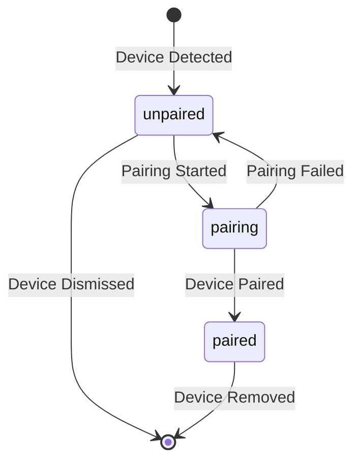

# DevicePairingStatus

A small status indicator (icon + text) that shows a Device's **Pairing Status**: is this Hub or Module part of the Account yet?

It is the first component of the design system, so it is deliberately small: one prop that matters, three states, no buttons.

Based on:

- [Device lifecycle → Pairing Status](/docs/architecture/domain-model/device-lifecycle.md#pairing-status)
- [Ubiquitous Language → Pairing Status](/docs/architecture/domain-model/ubiquitous-language.md#pairing-status)
- [UI component conventions](/docs/architecture/design-system/ui-component-conventions.md)
- [How to create a component → Checklist](/docs/architecture/design-system/how-to-create-a-component.md#8-checklist-for-every-component)

## Table of contents

[What it shows](#what-it-shows)

[What it doesn't show](#what-it-doesnt-show)

[States](#states)

[Lifecycle](#lifecycle)

[Anatomy](#anatomy)

[Props](#props)

[Tokens](#tokens)

[Accessibility](#accessibility)

[Usage](#usage)

[Stories](#stories)

[Files](#files)

[Open questions](#open-questions)

## What it shows

Pairing Status has exactly three values, taken from the glossary:

| Pairing Status | Meaning |
| --- | --- |
| **Unpaired** | The Device has been detected, but the user hasn't added it yet. |
| **Pairing** | First-time setup is running. |
| **Paired** | The Device belongs to the Account. |

The component turns one of those values into a coloured icon and a short label.

## What it doesn't show

The glossary splits Device Status into **three separate fields**. This component shows only the first one.

| Field | Shown here? | Where it belongs |
| --- | --- | --- |
| Pairing Status | Yes | `DevicePairingStatus` |
| Connection Status (Connecting, Connected, Stale, Disconnected) | No | A future `DeviceConnectionStatus` |
| Fault | No | A future `DeviceFault` |

Why keep them apart? Connection Status only exists while a Device is Paired (lifecycle rule 1), and a Fault can appear on top of any status (rule 7). One component per field means you can't accidentally show impossible combinations like "Unpaired and Stale".

Also out of scope:

- The **Add** and **Not now** buttons from "New module found". Those are actions (Pair Device and Dismiss Device commands), so they belong in a bigger card that _uses_ this component.
- Telling the user that pairing **failed**. Pairing Failed is an event, not a status: the Device simply goes back to Unpaired. See [Open questions](#open-questions).

## States

| State | `status` value | Tone | Icon | Label | Component state |
| --- | --- | --- | --- | --- | --- |
| Unpaired | `'unpaired'` | neutral | Dashed circle / plus | Unpaired | default |
| Pairing | `'pairing'` | progress | Spinner (animated) | Pairing… | loading |
| Paired | `'paired'` | success | Check mark | Paired | default |

Notes:

- Labels use the glossary words exactly, as `CLAUDE.md` asks for UI copy. The lifecycle doc suggests friendlier copy ("Setting up…"); see [Open questions](#open-questions).
- **Pairing is the loading state.** The spinner shows that something is happening.
- The other target states from `CLAUDE.md` (Connected, Stale, Disconnected, Fault) **don't apply** to this component. They belong to Connection Status and Fault. This is intentional, not a missing story.

## Lifecycle

The component doesn't move between states by itself. The app passes a new `status` when an event arrives, and the component re-renders.



When the Device leaves the lifecycle (Dismissed or Removed), the app stops rendering the component. There is no "removed" state.

## Anatomy

```
┌──────────────────────┐
│  (icon)  Label       │
└──────────────────────┘
   1        2
   └── 3: container ───┘
```

1. **Icon**: the shape tells the state apart without relying on colour. Decorative (`aria-hidden`), because the label already says the same thing.
2. **Label**: the Pairing Status as text.
3. **Container**: a pill with a tinted background and border in the state's tone.

## Props

```ts
export type PairingStatus = 'unpaired' | 'pairing' | 'paired';

export interface DevicePairingStatusProps {
  /** The Device's Pairing Status. */
  status: PairingStatus;
  /** Extra class name for layout tweaks from the parent (margin, alignment). */
  className?: string;
}
```

- `status` values are lowercase string literals, as the [frontend conventions](/docs/architecture/frontend/frontend-conventions.md) require.
- `PairingStatus` will be needed by other components too (cards, lists), so it goes in `src/types/`, not inside the component folder.
- No `label` prop for now. Copy comes from the glossary, and keeping it fixed keeps the UI consistent. We can add it later if translations need it.
- No `deviceKind` prop. Hubs and Modules have the same Pairing Statuses, so the indicator looks the same for both.

## Tokens

Only `var(--shk-…)` tokens, inside `@layer detriz`. No raw colours or sizes.

| Part | Unpaired | Pairing | Paired |
| --- | --- | --- | --- |
| Background | `--shk-status-neutral-bg` | `--shk-status-progress-bg` | `--shk-status-success-bg` |
| Border | `--shk-status-neutral-border` | `--shk-status-progress-border` | `--shk-status-success-border` |
| Text and icon | `--shk-status-neutral-fg` | `--shk-status-progress-fg` | `--shk-status-success-fg` |

Shared by every state:

| Part | Token |
| --- | --- |
| Text style | `--shk-typography-label-*` (font family, size, weight, line height, letter spacing) |
| Gap between icon and label | `--shk-space-1` (4px) |
| Padding | `--shk-space-1` vertical, `--shk-space-2` horizontal |
| Corner radius | `--shk-radius-full` (pill) |
| Border width | a `--shk-border-width-*` token (thinnest one) |

Icon colour uses `currentColor`, so it follows the text colour automatically.

## Accessibility

- **Not colour alone.** Each state has its own icon _and_ label, so it works for colour-blind users and in greyscale.
- **Announces changes.** The container has `role="status"`, so screen readers read the new label when Unpaired turns into Pairing, then into Paired, without moving focus.
- **Busy while pairing.** In the Pairing state the container gets `aria-busy="true"`.
- **Reduced motion.** With `prefers-reduced-motion: reduce`, the spinner stops rotating. The "…" in the label still shows that work is in progress.
- **Contrast.** `*-fg` on `*-bg` must reach at least 4.5:1 (WCAG AA for small text). Check this for all three tones.
- **Not interactive.** It's a `<span>`, not a button. It can't be focused or clicked.

## Usage

```tsx
import { DevicePairingStatus } from '@detriz-sh-kit/ui';

<DevicePairingStatus status="pairing" />
```

Do:

- Show it next to the Device name in lists of Hubs and Modules.
- Show it inside "New module found" while the user waits after tapping **Add**.

Don't:

- Show it together with a connection badge on a Paired Device in normal use. Once a Device is Paired, Connection Status is the more useful information; "Paired" can be implied.
- Pass Connection Status values into it (`'connected'`, `'stale'`…). TypeScript will refuse them.
- Fetch the status inside it. It is presentational: the parent passes `status`.

## Stories

One story per state, plus one overview:

| Story | Props |
| --- | --- |
| `Unpaired` | `status="unpaired"` |
| `Pairing` | `status="pairing"` |
| `Paired` | `status="paired"` |
| `AllStatuses` | All three side by side, to compare them |

## Files

```
kit/packages/ui/src/
├── components/status/DevicePairingStatus/
│   ├── DevicePairingStatus.md           ← this file
│   ├── DevicePairingStatus.tsx          ← component
│   ├── DevicePairingStatus.module.css   ← styles (tokens only)
│   └── DevicePairingStatus.stories.tsx  ← stories
├── types/
│   └── device.ts                        ← PairingStatus type
└── index.ts                             ← exports DevicePairingStatus, DevicePairingStatusProps, PairingStatus
```

## Open questions

- **Glossary words or friendly copy?** The glossary says "Unpaired / Pairing / Paired"; the lifecycle doc suggests "Setting up…" for Pairing and "New module found" for Unpaired. Which one is the UI copy?
- **Showing that pairing failed.** After Pairing Failed the Device is Unpaired again, so the user may not notice it failed. Should the parent show a message (toast, inline error), or should this component get an optional "failed" hint?
- **Icons.** The `icons/` folder is empty. Do we create `IconCheck`, `IconSpinner` and `IconUnpaired` as part of this component, or design them in Figma first?
- **Size.** Is one size enough, or do we need a compact version for dense lists?
